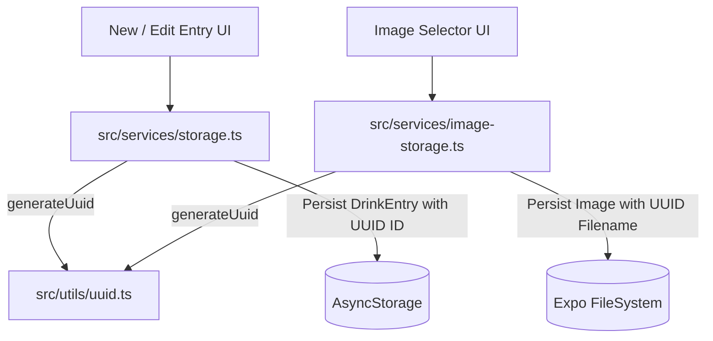

# Requirements

### Overview & Goals
The objective is to replace ad-hoc timestamp and random string identifiers for drink entries and persisted images with standard RFC 4122 v4 UUIDs. This prepares the client application for bidirectional synchronization with the backend (`tasteney-be`), ensuring unique, collision-resistant primary keys and predictable entity mapping.

### Scope
- **In Scope:**
  - Standardized UUID v4 generator utility for React Native/Expo.
  - Updating `DrinkEntry.id` generation in `src/services/storage.ts` from `drink_${Date.now()}_...` to UUID v4.
  - Migrating legacy entry IDs stored in AsyncStorage on read/initialization to ensure all entries have valid UUIDs.
  - Updating image file naming in `src/services/image-storage.ts` from `img_${Date.now()}_...` to UUID-based filenames.
  - Supporting UUID extraction from image paths to facilitate backend synchronization payloads.
  - Maintaining full backward compatibility for existing local images and legacy entries.
- **Out of Scope:**
  - Implementing full backend sync endpoints or network sync protocols (this task prepares the data layer).
  - Modifying backend database schemas in `tasteney-be`.

### User Stories
- **As a User**, I want my entries and attached photos to have stable, globally unique identifiers so that when my data syncs to the cloud, no entries or images conflict or get overwritten.
- **As a Developer**, I want predictable UUID v4 identifiers across entries and images so that local storage models map 1:1 with backend database primary and foreign keys.

### Functional Requirements
- Newly saved drink entries must be assigned a valid RFC 4122 v4 UUID string (e.g., `123e4567-e89b-12d3-a456-426614174000`).
- Newly persisted images in `src/services/image-storage.ts` must use UUIDs in their filenames.
- Existing entries with legacy ID formats (`drink_...`) must be seamlessly migrated to valid UUIDs upon storage access.
- Image resolution (`resolveImageUri`) and deletion (`deleteImageFile`) must support both new UUID filenames and legacy filenames.

### Non-Functional Requirements
- **Reliability:** Zero data loss during legacy entry migration.
- **Compatibility:** Cross-platform support across iOS, Android, and Web.
- **Performance:** Instantaneous synchronous/asynchronous UUID generation with negligible overhead.

# Technical Design

### Current Implementation
- `src/services/storage.ts` generates IDs using:
  ```ts
  id: targetId || `drink_${Date.now()}_${Math.random().toString(36).substring(2, 9)}`
  ```
- `src/services/image-storage.ts` persists images using:
  ```ts
  const filename = `img_${Date.now()}_${Math.random().toString(36).substring(2, 9)}.${ext}`;
  ```
- `DrinkEntry.id` is a string, and `DrinkEntry.images` is an array of relative paths (`drink_images/...`).

### Key Decisions
1. **UUID Generation Method:** Use `expo-crypto` (`Crypto.randomUUID()`) or standard `crypto.randomUUID()` in a centralized helper (`src/utils/uuid.ts`). This guarantees standard, cryptographically secure v4 UUIDs on all supported platforms (iOS, Android, Web).
2. **Image Identifier Strategy:** Name persisted image files as `img_${uuid}.${ext}` (or `${uuid}.${ext}`) stored under `drink_images/`. This allows extracting the image's UUID directly from its path via a helper function (`extractImageUuid`), maintaining direct compatibility with `images: string[]` while enabling relational mapping for backend sync.
3. **Transparent In-Memory & Disk Migration:** When `getRawDrinkEntries()` reads stored entries from AsyncStorage, any entry with a non-UUID ID is assigned a new UUID and saved back to AsyncStorage asynchronously, ensuring all entries become UUID-compliant without manual user intervention.

### Proposed Changes
- **`src/utils/uuid.ts`**:
  - Implement `generateUuid(): string` using `expo-crypto` / `crypto.randomUUID()`.
  - Implement `isValidUuid(id: string): boolean` helper for format validation.
- **`src/services/storage.ts`**:
  - Replace timestamp/random string generator in `saveDrinkEntry()` with `generateUuid()`.
  - Add migration check in `getRawDrinkEntries()` to ensure all loaded entries conform to UUID format.
- **`src/services/image-storage.ts`**:
  - Update `persistImage()` to generate filenames with `generateUuid()`.
  - Add `extractImageUuid(storedUri: string): string | null` to extract the UUID from image paths.
  - Update regex in `resolveImageUri()` to recognize UUID-formatted filenames in addition to legacy filenames.

### Data Models / Contracts
```ts
// src/utils/uuid.ts
export function generateUuid(): string;
export function isValidUuid(id: string): boolean;

// src/services/image-storage.ts
export function extractImageUuid(storedUri: string | null | undefined): string | null;
```

### Architecture Diagram


### Risks & Mitigations
- **Legacy ID references:** If old entries had `drink_...` IDs, updating their IDs could theoretically break bookmarks or external links. *Mitigation:* The app uses purely internal local storage routes, so updating the ID in storage and returning the updated entity preserves complete data consistency.
- **Image filename parsing:** Strict regexes might fail to resolve legacy files. *Mitigation:* Ensure `resolveImageUri()` supports both UUID format and legacy `img_\d+_[a-zA-Z0-9]+` formats.

# Testing

### Validation Approach
Verification will be performed by testing UUID generation across the entry lifecycle, validating file system storage naming, ensuring legacy migration behaves idempotently, and running static type/lint checks.

### Key Scenarios
- **New Entry Creation:**
  - Create a new drink entry with photos.
  - Verify that `entry.id` matches standard UUID v4 format (`/^[0-9a-f]{8}-[0-9a-f]{4}-4[0-9a-f]{3}-[89ab][0-9a-f]{3}-[0-9a-f]{12}$/i`).
  - Verify that persisted image filenames in `entry.images` contain valid UUIDs.
- **Entry Editing:**
  - Edit an existing entry (add/remove photos, update rating/notes).
  - Verify that the original `entry.id` is preserved and newly added photos receive UUID filenames while deleted photos are cleanly removed from disk.
- **Legacy Migration:**
  - Simulate an existing AsyncStorage dataset containing `drink_123456_abc` entries and `img_123456_abc.jpg` files.
  - Load entries via `getDrinkEntries()` and verify all entries receive valid UUIDs and all images render properly.

### Edge Cases
- Empty or missing images array.
- Remote/data URIs bypassed without corrupting UUID formatting.
- Image deletion when replacing an existing photo during edit.

### Test Changes
- Execute `npm run lint` / `npx expo lint` and TypeScript compilation checks to guarantee type safety and code quality.

# Delivery Steps

### ✓ Step 1: Implement UUID generation in storage service
Standardized UUID generation is available across the app and newly created entries possess valid RFC 4122 v4 UUIDs.

- Add `expo-crypto` dependency or a dedicated `src/utils/uuid.ts` helper providing a deterministic, cross-platform `generateUuid()` function.
- Update `saveDrinkEntry` in `src/services/storage.ts` to assign `generateUuid()` when creating new entries instead of `drink_${Date.now()}_...`.
- Ensure type definitions in `src/types/drink.ts` and consumers in `src/app/new-entry.tsx` and `src/app/entry-detail.tsx` work seamlessly with UUID identifiers.

### ✓ Step 2: Update image storage with UUID filenames
Persisted image files and relative paths use UUID-based naming conventions.

- Update `persistImage` in `src/services/image-storage.ts` to generate UUID-based filenames (`img_${uuid}.${ext}` or `${uuid}.${ext}`) using `generateUuid()`.
- Provide an `extractImageUuid(storedUri)` utility to extract or map image UUIDs for backend synchronization payloads.
- Update `resolveImageUri()` and `deleteImageFile()` to resolve UUID-formatted image files.
- Verify image handling in `src/components/image-selector.tsx`, `src/app/new-entry.tsx`, and `src/app/entry-detail.tsx` to ensure zero regressions in thumbnail and hero image rendering.

### ✓ Step 3: Verify entry and image UUID generation and storage integrity
Full entry lifecycle with image attachments verifies that all generated identifiers and file paths conform to UUID v4 standards without regressions.

- Execute TypeScript typechecks and ESLint checks to validate interface and module integrity.
- Verify creation, editing, retrieval, and deletion of entries with single and multiple image attachments.