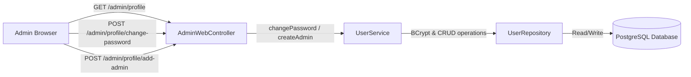

# Requirements

### Overview & Goals
Provide a dedicated administrative user page within the Tasteney back-office (`/admin/profile`) allowing authenticated administrators to:
1. Safely change their own account password by verifying their existing credentials.
2. Provision new administrator accounts (`ROLE_ADMIN`) with email and password credentials.

### Scope
- **In Scope**:
  - New admin user page route (`/admin/profile`) within the Spring Boot admin web module.
  - Password change functionality with current-password validation and length constraints.
  - New administrator registration functionality restricted to authenticated admins.
  - Navbar navigation linking between the main dashboard and the admin profile/management page.
  - Feedback notifications (success and error messages) using Spring MVC flash attributes.
  - Modular integration adhering to Spring Modulith boundaries (`user` public API and `admin` web layer).
- **Out of Scope**:
  - Self-service password reset flows via email tokens or SMTP.
  - Deleting or demoting the primary initial admin account.
  - Mobile app authentication changes.

### User Stories
- **As an Administrator**, I want to navigate to my user profile page so that I can manage my administrative credentials.
- **As an Administrator**, I want to change my password by providing my current password and a new secure password so that my account remains protected.
- **As an Administrator**, I want to add new administrators by entering their email address and initial password so that additional team members can access the admin dashboard.

### Functional Requirements
1. **Admin Profile View (`GET /admin/profile`)**:
   - Accessible only to authenticated users with `ROLE_ADMIN`.
   - Displays the logged-in admin's email and role.
   - Lists existing administrators (email, registered date).
2. **Change Password (`POST /admin/profile/change-password`)**:
   - Accepts `currentPassword`, `newPassword`, and `confirmPassword`.
   - Validates that `currentPassword` matches the current hashed password in database.
   - Validates that `newPassword` meets minimum length requirements (min 6 characters) and matches `confirmPassword`.
   - Updates password hash using BCrypt and updates `updated_at` timestamp.
   - Shows clear success message or validation error alert on completion.
3. **Add Administrator (`POST /admin/profile/add-admin`)**:
   - Accepts `email` and `password`.
   - Validates email format and password minimum length (min 6 characters).
   - Validates that email is not already registered in the system.
   - Creates new user with role `UserRole.ADMIN`.
   - Shows success message with the created admin email or error alert on failure.
4. **Navigation Integration**:
   - The top navigation bar in both `/admin/dashboard` and `/admin/profile` includes links to navigate between "Dashboard" and "Admin Profile".

### Non-Functional Requirements
- **Security**: All endpoints protected under Spring Security `@Order(1)` admin chain; CSRF protection enabled and enforced on all form submissions.
- **Modularity**: Strict encapsulation adhering to Spring Modulith rules—`admin` controller interacts with user management solely through public `UserService` methods.
- **UI Consistency**: The profile page follows the design system and dark theme palette established in `dashboard.html`.

# Technical Design

### Current Implementation
- **Admin Module (`biz.web4my.tasteney_be.admin`)**:
  - `AdminWebController.kt`: Handles `/admin/login` and `/admin/dashboard`.
  - `AdminHtmxController.kt`: Handles dynamic search and filtering fragments at `/admin/htmx/users`.
  - Thymeleaf templates in `src/main/resources/templates/admin/`.
- **User Module (`biz.web4my.tasteney_be.user`)**:
  - `UserService.kt`: Exposes `register`, `findByEmail`, `findById`, `findAll`, `countUsers`, `countAdmins`.
  - `UserServiceImpl.kt`: Implements registration (defaulting to `UserRole.USER`) and user querying.
- **Security Module (`biz.web4my.tasteney_be.security`)**:
  - `SecurityConfiguration.kt`: Secures `/admin/**` requiring `ROLE_ADMIN` via form login.

### Key Decisions
1. **Public API Contract in `UserService`**: Add dedicated `changePassword` and `createAdmin` methods to `UserService` rather than exposing internal entities or generic update methods, preserving Spring Modulith module boundaries.
2. **Form Submission & Feedback Flow**: Use standard Spring MVC POST handling with `RedirectAttributes` (Flash attributes) for robust form submission, PRG (Post-Redirect-Get) pattern, and CSRF compliance across full page reloads.
3. **Unified Navigation Bar**: Standardize navigation links in the header across all admin templates (`dashboard.html` and `profile.html`) for consistent user experience.

### Proposed Changes
- **User Module**:
  - Add `ChangePasswordRequest` and `CreateAdminRequest` data classes in `UserRequests.kt`.
  - Update `UserService` interface with `changePassword(userId: UUID, request: ChangePasswordRequest)` and `createAdmin(request: CreateAdminRequest): UserDto`.
  - Implement both methods in `UserServiceImpl` with BCrypt hashing and error checking.
- **Admin Module**:
  - Add profile routes to `AdminWebController`:
    - `GET /admin/profile`
    - `POST /admin/profile/change-password`
    - `POST /admin/profile/add-admin`
  - Create `src/main/resources/templates/admin/profile.html`.
  - Update `src/main/resources/templates/admin/dashboard.html` navbar with link to profile.

### Data Models / Contracts
```kotlin
// biz/web4my/tasteney_be/user/UserRequests.kt
data class ChangePasswordRequest(
    @field:NotBlank(message = "Current password is required")
    val currentPassword: String,

    @field:NotBlank(message = "New password is required")
    @field:Size(min = 6, message = "Password must be at least 6 characters")
    val newPassword: String,

    @field:NotBlank(message = "Password confirmation is required")
    val confirmPassword: String
)

data class CreateAdminRequest(
    @field:NotBlank(message = "Email is required")
    @field:Email(message = "Email must be valid")
    val email: String,

    @field:NotBlank(message = "Password is required")
    @field:Size(min = 6, message = "Password must be at least 6 characters")
    val password: String
)

// biz/web4my/tasteney_be/user/UserService.kt
interface UserService {
    // Existing methods...
    fun changePassword(userId: UUID, request: ChangePasswordRequest)
    fun createAdmin(request: CreateAdminRequest): UserDto
}
```

### File Structure
```
tasteney-be/
├── src/main/kotlin/biz/web4my/tasteney_be/
│   ├── admin/
│   │   └── AdminWebController.kt                     # Modified: added profile and management endpoints
│   └── user/
│       ├── UserRequests.kt                           # Modified: added ChangePasswordRequest & CreateAdminRequest
│       ├── UserService.kt                            # Modified: added changePassword and createAdmin
│       └── internal/
│           └── UserServiceImpl.kt                    # Modified: implemented password change and admin creation
├── src/main/resources/templates/admin/
│   ├── dashboard.html                                # Modified: added navigation link to Profile
│   └── profile.html                                  # Added: admin user profile & management template
└── src/test/kotlin/biz/web4my/tasteney_be/
    ├── admin/
    │   └── AdminWebControllerTest.kt                 # Modified: tests for profile, password change & add admin
    └── user/
        └── UserServiceTest.kt                        # Added/Modified: tests for changePassword & createAdmin
```

### Architecture Diagram


### Risks
- **Session invalidation on password change**: If current admin changes password, their current active session remains valid in Spring Session JDBC until sign out or timeout; if strict re-authentication is desired, session invalidation can be triggered.
- **CSRF Token mismatch on form submissions**: Ensure all Thymeleaf forms include hidden CSRF input elements compatible with Spring Security `@Order(1)` chain.

# Testing

### Validation Approach
Verification will be performed through automated Spring Boot tests covering controller endpoints, security boundaries, and service logic.

### Key Scenarios
1. **Access Control**:
   - Unauthenticated requests to `/admin/profile` are redirected to `/admin/login`.
   - Users with `ROLE_USER` receive `403 Forbidden` when accessing `/admin/profile`.
   - Users with `ROLE_ADMIN` can view `/admin/profile`.
2. **Password Change Workflow**:
   - Submitting valid current password with matching new passwords successfully updates the password hash in the database.
   - Submitting an incorrect current password returns an error flash message without modifying the database.
   - Submitting mismatched `newPassword` and `confirmPassword` returns a validation error.
   - Submitting a new password shorter than 6 characters returns a validation error.
3. **Administrator Provisioning Workflow**:
   - An authenticated admin can register a new admin with unique email and password (minimum 6 characters).
   - Created admin account has role `UserRole.ADMIN`.
   - Attempting to register an admin with an existing email returns a conflict error alert.
   - Newly created admin can successfully log in at `/admin/login`.

### Test Changes
- **`AdminWebControllerTest.kt`**: Add tests for profile page rendering, successful password change redirect, invalid current password failure, and admin creation success/conflict.
- **`UserServiceTest.kt`**: Add unit tests verifying `changePassword` logic, password verification, hashing, and `createAdmin` role assignment.
- **`ModulithArchitectureTests.kt`**: Re-verify modularity constraints.

# Delivery Steps

### ✓ Step 1: Extend User Module with Password Management and Admin Creation
The user service supports changing account passwords with validation and provisioning new administrator accounts.

- Create request DTOs `ChangePasswordRequest` and `CreateAdminRequest` with Jakarta validation annotations in `biz.web4my.tasteney_be.user.UserRequests.kt`.
- Add `changePassword(userId: UUID, request: ChangePasswordRequest)` and `createAdmin(request: CreateAdminRequest): UserDto` methods to `UserService` interface.
- Implement `changePassword` in `UserServiceImpl` verifying current password with `PasswordEncoder`, encoding the new password, updating timestamps, and persisting changes.
- Implement `createAdmin` in `UserServiceImpl` verifying email uniqueness, hashing password, assigning `UserRole.ADMIN`, and persisting the new account.
- Add unit tests for `changePassword` and `createAdmin` in `tasteney-be/src/test/kotlin/biz/web4my/tasteney_be/user/`.

### ✓ Step 2: Implement Admin Web Controller Endpoints and Security Routing
The admin controller handles routing and form submissions for viewing admin profile, updating password, and registering new administrators.

- Add `GET /admin/profile` in `AdminWebController` to render the admin user page with current admin info and list of administrators.
- Add `POST /admin/profile/change-password` in `AdminWebController` to handle password updates with feedback via Spring MVC flash attributes (`RedirectAttributes`).
- Add `POST /admin/profile/add-admin` in `AdminWebController` to handle new admin creation with input validation and feedback via flash attributes.
- Update `SecurityConfiguration` verification to ensure all new endpoints under `/admin/profile/**` inherit `@Order(1)` admin chain protection.

### ✓ Step 3: Create Admin Profile Template, Navigation, and Integration Tests
The admin UI includes a dedicated profile and management page accessible from the navbar with forms for changing passwords and adding admins.

- Create `src/main/resources/templates/admin/profile.html` styled with existing dark theme tokens, featuring current profile card, change password form, and add administrator form with error/success alerts.
- Update `src/main/resources/templates/admin/dashboard.html` navbar with navigation links between "Dashboard" and "Admin Profile".
- Implement controller and integration tests in `AdminWebControllerTest` covering access control, password change validation, and admin creation flows.
- Run `ModulithArchitectureTests` to verify Spring Modulith architectural boundaries remain compliant.