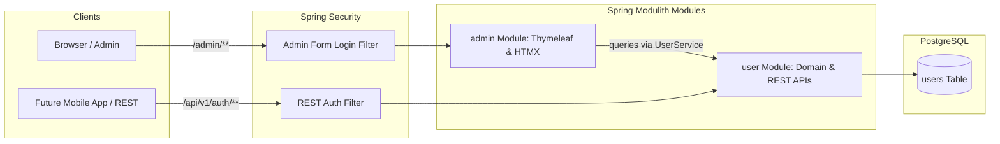

# Requirements

### Overview & Goals
Establish the foundational backend architecture and identity services for Tasteney in `tasteney-be` using Kotlin, Spring Boot 4.x, and Spring Modulith. This change introduces user registration and authentication, role-based access control (`USER` and `ADMIN`), automatic bootstrapping of an initial administrator (`admin-001@tasteney.com`), a dedicated Thymeleaf + HTMX administrative dashboard, and updated developer documentation in `AGENTS.md`.

### Scope
- **In Scope**:
  - Flyway migration for user persistence in PostgreSQL via Spring Data JDBC.
  - Core `user` module with registration, authentication, role assignment, and password hashing (`BCrypt`).
  - Spring Security configuration with dual authentication flows (REST API session/token support and `/admin/**` Form Login).
  - First-time startup initialization for `admin-001@tasteney.com` supporting `INITIAL_ADMIN_PASSWORD` env var with secure random fallback logged to console.
  - Thymeleaf & HTMX back-office web interface (`/admin/login`, `/admin/dashboard`) restricted strictly to `ADMIN` role.
  - Spring Modulith modular encapsulation with architecture verification tests.
  - Updates to `AGENTS.md` documenting backend architecture, conventions, and security workflows.
- **Out of Scope**:
  - Frontend (`tasteney/`) integration with backend APIs (explicitly deferred per user instruction).
  - OAuth2 / Social Login integrations.
  - Email confirmation and password reset workflows.

### User Stories
- **As a User**, I want to register an account and log in via API endpoints so that my tasting notes can eventually be securely stored and synchronized.
- **As an Administrator**, I want an initial administrative account provisioned automatically on first startup so that the platform can be managed without manual database tampering.
- **As an Administrator**, I want to log in through a web interface and view a searchable dashboard of all registered users so that I can inspect and monitor platform adoption.
- **As a Developer / AI Agent**, I want modular boundaries and clear architectural rules documented in `AGENTS.md` so that future features adhere to clean code principles without regressions.

### Functional Requirements
- **FR-1 (Registration)**: `POST /api/v1/auth/register` accepts email and password, validates input format and email uniqueness, hashes the password with BCrypt, assigns the `USER` role, and returns user details.
- **FR-2 (Authentication)**: `POST /api/v1/auth/login` verifies credentials, initiates an authenticated session, and returns current user info. `POST /api/v1/auth/logout` terminates the session. `GET /api/v1/auth/me` returns the authenticated user's profile.
- **FR-3 (Roles & Permissions)**: Roles are explicitly typed as `USER` and `ADMIN`. Endpoints under `/admin/**` require `hasRole('ADMIN')`.
- **FR-4 (Initial Admin Seeding)**: On startup, if `admin-001@tasteney.com` is missing, create it with role `ADMIN`. Use `INITIAL_ADMIN_PASSWORD` if provided; otherwise generate a cryptographically secure 20-character random password and log it to the console.
- **FR-5 (Admin Web Portal)**:
  - `/admin/login`: Form-based login page for administrators.
  - `/admin/dashboard`: Server-rendered dashboard displaying system statistics and a table of registered users (ID, email, role, creation timestamp).
  - HTMX dynamic live-filtering and instant table refreshing without full page reloads.
- **FR-6 (Documentation)**: Update `AGENTS.md` with backend guidelines, module boundaries, security model, and testing procedures.

### Non-Functional Requirements
- **Modularity**: Strict Spring Modulith package structure ensuring `admin` depends on `user` through public interfaces without violating cyclic dependencies.
- **Security**: Passwords salted and hashed with BCrypt. Protected admin routes return 401/403 or redirect unauthenticated requests to `/admin/login`.
- **Reliability & Idempotency**: Startup initializer is idempotent and safe against repeated container restarts.
- **Maintainability**: Clear separation between server-rendered HTML views and JSON REST endpoints.

# Technical Design

### Current Implementation
`tasteney-be` is currently an initial Spring Boot 4.1.x application with Kotlin 2.3 and Java 21. Dependencies for Spring Data JDBC, Flyway, Spring Security, Spring Session JDBC, and Spring Modulith are configured in `pom.xml`, but no domain entities, database migrations, security filters, or web templates exist yet.

### Key Decisions
1. **Two-Module Spring Modulith Layout**:
   - `user`: Owns domain models, database persistence, password hashing, user registration/auth REST controllers, and public query services.
   - `admin`: Owns Thymeleaf controllers, HTMX fragment endpoints, and web view templates, depending on `user` public APIs.
   - *Rationale*: Keeps back-office HTML rendering separated from core domain and REST services, preventing presentation coupling while maintaining clean modular boundaries.
2. **Dual SecurityFilterChain Architecture**:
   - Chain 1 (Admin Web): Matches `/admin/**`, uses standard Form Login, redirects to `/admin/dashboard`, enforces `hasRole('ADMIN')`.
   - Chain 2 (REST API): Matches `/api/**`, handles JSON requests, disables CSRF for API endpoints (or configures session-cookie CSRF), returns 401 Unauthorized for unauthenticated requests.
   - *Rationale*: Provides optimal user experience for browser-based admin interactions while offering clean JSON responses for REST clients.
3. **Admin Credential Bootstrapping**:
   - Check presence of `admin-001@tasteney.com`. If missing, read `INITIAL_ADMIN_PASSWORD` property, falling back to `SecureRandom` 20-char generator, and log credentials clearly to startup output.
   - *Rationale*: Eliminates fragile manual DB seeding, works out-of-the-box in local development, and allows secure configuration injection in containerized deployments.
4. **Thymeleaf + HTMX for Admin UI**:
   - Use `spring-boot-starter-thymeleaf` with HTMX for responsive live search and partial table refreshes (`hx-get`, `hx-target`, `hx-swap`).
   - *Rationale*: Maximizes developer productivity and operational simplicity with zero Node/bundler overhead on the backend.

### Proposed Changes
- Add `spring-boot-starter-thymeleaf` to `pom.xml`.
- Add Flyway migration `V1__create_users_table.sql`.
- Implement `biz.web4my.tasteney_be.user` module (Entity, Repository, Service, RestController, Initializer).
- Implement `biz.web4my.tasteney_be.admin` module (WebController, HtmxController, Thymeleaf templates).
- Implement `biz.web4my.tasteney_be.security` configuration.
- Implement architecture test with Spring Modulith verification.
- Update `AGENTS.md` with complete backend architecture and workflow guidelines.

### Data Models / Contracts

#### Database Schema (`db/migration/V1__create_users_table.sql`)
```sql
CREATE TABLE IF NOT EXISTS users (
    id UUID PRIMARY KEY DEFAULT gen_random_uuid(),
    email VARCHAR(255) NOT NULL UNIQUE,
    password_hash VARCHAR(255) NOT NULL,
    role VARCHAR(32) NOT NULL,
    created_at TIMESTAMP WITH TIME ZONE NOT NULL DEFAULT CURRENT_TIMESTAMP,
    updated_at TIMESTAMP WITH TIME ZONE NOT NULL DEFAULT CURRENT_TIMESTAMP
);

CREATE INDEX idx_users_email ON users(email);
CREATE INDEX idx_users_role ON users(role);
```

#### Domain Models & Enums
```kotlin
package biz.web4my.tasteney_be.user

import java.time.Instant
import java.util.UUID

enum class UserRole {
    USER,
    ADMIN
}

data class UserDto(
    val id: UUID,
    val email: String,
    val role: UserRole,
    val createdAt: Instant,
    val updatedAt: Instant
)
```

#### REST Contracts (`/api/v1/auth`)
- `POST /api/v1/auth/register`
  - Request: `{ "email": "user@example.com", "password": "securePassword123" }`
  - Response: `201 Created` -> `{ "id": "...", "email": "user@example.com", "role": "USER", "createdAt": "..." }`
- `POST /api/v1/auth/login`
  - Request: `{ "email": "user@example.com", "password": "securePassword123" }`
  - Response: `200 OK` -> `{ "id": "...", "email": "user@example.com", "role": "USER", "createdAt": "..." }`
- `GET /api/v1/auth/me`
  - Response: `200 OK` -> `{ "id": "...", "email": "user@example.com", "role": "USER", "createdAt": "..." }`
- `POST /api/v1/auth/logout`
  - Response: `204 No Content`

#### Admin Routes & HTMX Endpoints
- `GET /admin/login` -> Renders login form.
- `GET /admin/dashboard` -> Renders full admin dashboard shell.
- `GET /admin/htmx/users?query=&role=` -> Returns `fragments/user-table.html` containing filtered user rows.

### File Structure
```
tasteney-be/
├── pom.xml                                           # Added spring-boot-starter-thymeleaf
├── src/main/resources/
│   ├── application.properties                        # Base configuration
│   ├── application-DEV.properties                    # Local PostgreSQL & Flyway config
│   ├── db/migration/
│   │   └── V1__create_users_table.sql                # User table migration
│   └── templates/admin/
│       ├── login.html                                # Admin login page
│       ├── dashboard.html                            # Admin dashboard shell
│       └── fragments/
│           └── user-table.html                       # HTMX user table fragment
└── src/main/kotlin/biz/web4my/tasteney_be/
    ├── TasteneyBeApplication.kt
    ├── security/
    │   ├── SecurityConfiguration.kt                  # Multi-chain security & BCrypt bean
    │   └── UserDetailsServiceImpl.kt                 # Spring Security UserDetailsService
    ├── user/
    │   ├── UserDto.kt                                # Public DTO
    │   ├── UserRole.kt                               # Public Role enum
    │   ├── UserService.kt                            # Public interface for user ops
    │   └── internal/
    │       ├── User.kt                               # Spring Data JDBC Aggregate Root
    │       ├── UserRepository.kt                     # Data JDBC repository
    │       ├── UserServiceImpl.kt                    # Domain implementation
    │       ├── AuthRestController.kt                 # REST endpoints (/api/v1/auth)
    │       └── AdminUserInitializer.kt               # Startup seed for admin-001
    └── admin/
        ├── AdminWebController.kt                     # Page routing (/admin/login, /admin/dashboard)
        └── AdminHtmxController.kt                    # HTMX dynamic endpoints (/admin/htmx/users)
```

### Architecture Diagram


### Risks
- **CSRF Token Handling with HTMX**: HTMX requests from Thymeleaf pages require CSRF tokens when submitting POST actions.
  - *Mitigation*: Include Spring Security CSRF meta tags in Thymeleaf base layouts and configure `document.body.addEventListener('htmx:configRequest', ...)` to automatically append the CSRF header.
- **Accidental Public Exposure of Admin Endpoints**:
  - *Mitigation*: Explicit `@Order(1)` security chain configured strictly for `/admin/**` with `.hasRole('ADMIN')` rule, accompanied by integration tests asserting 403 Forbidden for unauthenticated or `USER`-role sessions.

# Testing

### Validation Approach
Verification will be performed at multiple levels:
1. **Modulith Architecture Validation**: Automated test verifying Spring Modulith module boundaries and dependency rules using `ApplicationModules`.
2. **Integration & WebMvc Tests**: Spring Boot slice and integration tests validating REST registration, authentication, role enforcement, and Thymeleaf/HTMX controller rendering.
3. **Database Migration Tests**: Verification that Flyway migrations execute successfully against PostgreSQL.
4. **Startup Bootstrapping Validation**: Verification that `admin-001@tasteney.com` is seeded on startup and the initialization is idempotent.

### Key Scenarios
- **Scenario 1: User Registration via REST API**
  - Given a valid email and password, `POST /api/v1/auth/register` creates a user with `USER` role and returns `201 Created`.
  - Repeated registration with the same email returns `409 Conflict` or `400 Bad Request`.
- **Scenario 2: User Login and Current User Session**
  - `POST /api/v1/auth/login` with valid credentials succeeds and returns user details.
  - Subsequent `GET /api/v1/auth/me` returns the authenticated user info.
- **Scenario 3: Initial Admin Account Generation**
  - On application startup with an empty database, `admin-001@tasteney.com` is persisted with `ADMIN` role.
  - The generated or configured password is logged to standard output.
  - Re-running the application leaves the existing admin account intact without modifying credentials.
- **Scenario 4: Admin Web Authentication and Access Control**
  - Unauthenticated access to `/admin/dashboard` redirects to `/admin/login`.
  - Authenticating as a `USER` role returns `403 Forbidden` for `/admin/dashboard`.
  - Authenticating as `admin-001@tasteney.com` succeeds and displays the dashboard.
- **Scenario 5: HTMX Real-Time User Filtering**
  - `GET /admin/htmx/users?query=alice` returns the HTML table fragment containing only matching user records.

### Edge Cases
- Invalid email format or blank password in registration request (returns `400 Bad Request` with validation error messages).
- Incorrect credentials on login (returns `401 Unauthorized` for REST and error attribute for form login).
- Special characters and search terms in HTMX search query (properly escaped in Thymeleaf to prevent XSS).
- Pre-existing admin account when `INITIAL_ADMIN_PASSWORD` is modified (existing account is preserved to prevent unexpected credential overwrites).

### Test Changes
- `src/test/kotlin/biz/web4my/tasteney_be/ModulithArchitectureTests.kt`: Asserts `ApplicationModules.of(TasteneyBeApplication::class.java).verify()`.
- `src/test/kotlin/biz/web4my/tasteney_be/user/AuthRestControllerTest.kt`: Unit & MockMvc tests for registration, login, logout, and me endpoints.
- `src/test/kotlin/biz/web4my/tasteney_be/user/AdminUserInitializerTest.kt`: Tests admin seeding logic and idempotency.
- `src/test/kotlin/biz/web4my/tasteney_be/admin/AdminWebControllerTest.kt`: Security tests verifying `/admin/**` authorization and HTMX fragment rendering.

# Delivery Steps

### ✓ Step 1: Configure build dependencies, database migrations, and Spring Modulith layout
The backend build configuration supports Thymeleaf, Flyway migrations create the user table, and Spring Modulith packages are structured.

- Add `spring-boot-starter-thymeleaf` dependency to `tasteney-be/pom.xml`.
- Create Flyway migration `V1__create_users_table.sql` in `src/main/resources/db/migration/` defining the `users` table schema (UUID primary key, unique email, password hash, role, and timestamps).
- Configure application properties for PostgreSQL, Flyway, and admin initialization in `application.properties` and `application-DEV.properties`.
- Establish package boundaries for `biz.web4my.tasteney_be.user` and `biz.web4my.tasteney_be.admin`.

### ✓ Step 2: Implement core User domain, security configuration, and authentication REST API
The User domain model, Spring Security filter chains, and REST registration/auth endpoints are fully operational.

- Define `User` entity, `UserRole` enum (`USER`, `ADMIN`), and Spring Data JDBC `UserRepository` in `biz.web4my.tasteney_be.user.internal`.
- Expose `UserService` public API and DTOs in `biz.web4my.tasteney_be.user` for registration, authentication validation, and user querying.
- Configure `SecurityFilterChain` in `biz.web4my.tasteney_be.security` providing dual protection: dedicated Form Login for `/admin/**` and JSON API security for `/api/**` with `BCryptPasswordEncoder`.
- Implement `AuthRestController` exposing `POST /api/v1/auth/register`, `POST /api/v1/auth/login`, `POST /api/v1/auth/logout`, and `GET /api/v1/auth/me`.

### ✓ Step 3: Implement initial Admin account seeding with configurable password fallback
The system guarantees that admin-001@tasteney.com is created on first startup using an environment override or a generated secure random password.

- Create `AdminUserInitializer` component in `biz.web4my.tasteney_be.user.internal` implementing `ApplicationRunner`.
- Check whether an account with email `admin-001@tasteney.com` exists in the database.
- If missing, read the `INITIAL_ADMIN_PASSWORD` environment property / configuration key, or generate a cryptographically secure 20-character random password using `SecureRandom`.
- Persist the admin user with role `ADMIN` and BCrypt-encoded password.
- Output a clear, prominent initialization banner in the application logs containing the initial admin email and generated password.

### ✓ Step 4: Build Thymeleaf & HTMX Admin login and user management dashboard
Administrators can log in via a dedicated web interface and view/search registered users dynamically with HTMX.

- Create `AdminWebController` in `biz.web4my.tasteney_be.admin` handling `/admin/login` and `/admin/dashboard` view rendering.
- Create `AdminHtmxController` handling dynamic user filtering, searching, and table refresh requests at `/admin/htmx/users`.
- Build Thymeleaf templates in `src/main/resources/templates/admin/`:
  - `login.html`: Clean, accessible login card for admin credentials.
  - `dashboard.html`: Admin back-office layout with navigation, summary metrics (total users, admins), and user table.
  - `fragments/user-table.html`: Reusable HTMX fragment for real-time search, sorting, and user listing.
- Embed HTMX and modern CSS styles for smooth interactions without full page reloads.

### ✓ Step 5: Add Modulith verification, backend tests, and update AGENTS.md documentation
Spring Modulith boundary rules, authentication flows, and admin dashboard operations are validated by automated tests and documented in AGENTS.md.

- Add Modulith architecture verification test in `TasteneyBeApplicationTests.kt` using `ApplicationModules.of(TasteneyBeApplication::class.java).verify()`.
- Add integration and controller tests for registration, authentication endpoints, and admin dashboard role-based access control (`403 Forbidden` for non-admin, `200 OK` for admin).
- Update `AGENTS.md` with backend architecture details: Spring Modulith two-module design, security filter architecture, Flyway migration rules, admin dashboard URLs, and initial credentials handling.