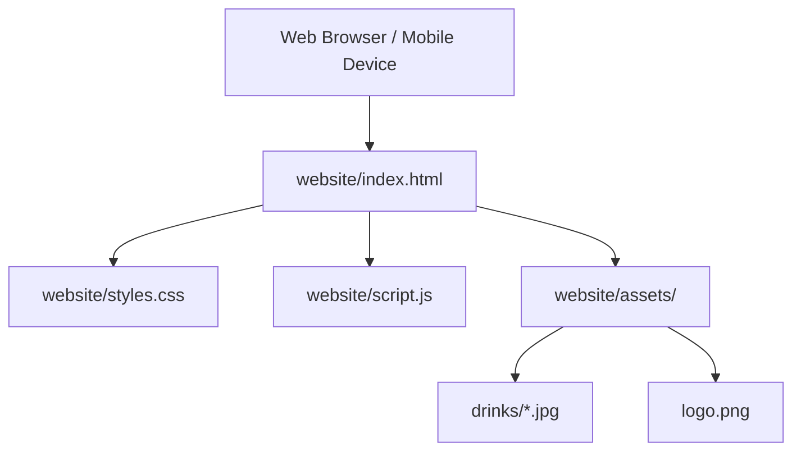

# Requirements

### Overview & Goals
The goal of this task is to design and build a standalone, simple, and mobile-friendly informational landing page for **Tasteney** in the `website/` directory. The website must be written in **German** and serve as a high-utility introduction to the app, highlighting its sensory journal capabilities, drink archetypes, flavor descriptor system, and offline-first philosophy.

### Scope
- **In Scope**:
  - Creating a self-contained static website (`index.html`, `styles.css`, `script.js`) in the `website/` directory.
  - Copying relevant drink photos and logo assets from `tasteney/assets/` into `website/assets/`.
  - Authoring clear German copy matching the terminology and translations established in `tasteney/src/i18n/locales/de.ts`.
  - Applying Tasteney's design language: warm ivory canvas (`#fcf9f4`), deep burgundy accents (`#4d0011`), gold details (`#c49a45`), pill shapes, and subtle glassmorphic container elevations.
  - Ensuring responsive, mobile-first design with smooth performance on smartphones, tablets, and desktop browsers.
  - Adding lightweight interactivity (such as interactive drink category inspection and tasting card preview).
- **Out of Scope**:
  - Complex frontend build tooling or bundling steps (plain HTML/CSS/JS is preferred for minimal overhead and instant utility).
  - Backend integration or server-side rendering for the public website.

### User Stories
- **As a prospective user / beverage enthusiast**, I want to visit the German landing page on my smartphone or desktop so that I can quickly understand what Tasteney does, explore supported drink categories, and see how the tasting journal and sensory flavor system work.
- **As a project maintainer**, I want a clean, zero-dependency static site in `website/` with copied assets so that it can be hosted anywhere (GitHub Pages, Netlify, Vercel, or any static HTTP server) without build steps.

### Functional Requirements
1. **German Language Localization**: All headings, body copy, labels, category names, and descriptions must be in natural, inviting German (e.g., "Verkostungstagebuch", "Sensorische Aromen", "Entdecken & Lernen").
2. **Hero Presentation**: Eye-catching hero section introducing the app ("Dein persönliches Verkostungstagebuch für Wein, Kaffee, Bier, Tee & Cocktails") with clear value propositions and visual preview.
3. **Core Features Section**:
   - *Verkostungstagebuch*: Log drinks with ratings (1–10), producer, origin, and personal impressions.
   - *Sensorik & Aromen-Guide*: Record flavor descriptors and intensity scores.
   - *Wissensdatenbank*: Encyclopedia with history, production methods, and serving advice.
   - *Lokale Datenspeicherung*: Privacy-focused, local-first storage.
4. **Interactive Category Gallery**: Visual grid featuring all 8 archetypes (Wein, Kaffee, Spirituosen, Bier, Tee, Soda & Tonics, Cocktails, Sonstiges) paired with authentic project imagery.
5. **Mobile Friendliness**: Fluid layout, accessible touch targets (min 44px), legible typography with scalable rem units, and clean hamburger/navigation drawer on smaller screens.

# Technical Design

### Current Implementation
- The repository contains the mobile/web frontend in `tasteney/` and the backend in `tasteney-be/`.
- Brand assets exist in `tasteney/assets/images/drinks/` (`wine.jpg`, `coffee.jpg`, `beer.jpg`, etc.) and `tasteney/assets/logo.png`.
- Design tokens and color themes are defined in `tasteney/src/constants/theme.ts` and `mockups/adding-new-entry/DESIGN.md`.
- Complete German domain terminology is maintained in `tasteney/src/i18n/locales/de.ts`.
- The `website/` folder is currently empty.

### Key Decisions
1. **Zero-Build Vanilla Stack (HTML5 + Modern CSS + Vanilla JS)**:
   - *Rationale*: Delivers maximum loading speed, zero maintenance burden, zero dependencies, and direct compatibility with any static hosting platform.
2. **Design Tokens & Typography**:
   - *Palette*: Surface canvas `#fcf9f4`, Surface containers `#f0ede9` / `#ffffff`, Primary Burgundy `#4d0011` / `#6b1724`, Secondary Warm Gold `#7b5902` / `#c49a45`, Text `#1c1c19`, Muted Text `#554243`.
   - *Typography*: High-legibility Google Fonts `Manrope` for UI/body and `Newsreader` (serif) for evocative headlines and tasting notes.
3. **Asset Organization**:
   - Static assets copied directly into `website/assets/` to ensure the landing page is completely self-contained.

### Architecture Diagram


### File Structure
```
website/
├── index.html                 # Main German landing page markup
├── styles.css                 # Custom responsive stylesheet & design system
├── script.js                  # Category preview & mobile menu interactions
└── assets/
    ├── logo.png               # Tasteney brand logo
    └── images/
        └── drinks/            # Copied drink archetype images
            ├── beer.jpg
            ├── cocktail.jpg
            ├── coffee.jpg
            ├── other.jpg
            ├── soda.jpg
            ├── spirits.jpg
            ├── tea.jpg
            └── wine.jpg
```

### Risks & Mitigations
- **Image file sizing**: Ensure copied images are rendered with CSS `aspect-ratio` and `object-fit: cover` with proper `loading="lazy"` attributes to prevent layout shifts on mobile connections.
- **Mobile viewport scrolling**: Use fluid clamp sizing (`clamp()`) for headings so text wraps cleanly on narrow screens (down to 320px).

# Testing

### Validation Approach
Verification of the created static website will be conducted by checking file completeness, asset references, markup semantics, responsive layout integrity, and German copy accuracy.

### Key Scenarios
1. **File & Asset Verification**:
   - Confirm all necessary assets (`logo.png`, `beer.jpg`, `cocktail.jpg`, `coffee.jpg`, `other.jpg`, `soda.jpg`, `spirits.jpg`, `tea.jpg`, `wine.jpg`) are present in `website/assets/`.
   - Confirm `website/index.html`, `website/styles.css`, and `website/script.js` load without broken links or missing files.
2. **German Copy & Domain Consistency**:
   - Verify all sections, labels, and descriptions are grammatically correct German and adhere to the translations from `de.ts`.
3. **Responsive Mobile & Desktop Layout**:
   - Check viewport meta tag and verify CSS media queries adapt layout from 1-column mobile scroll to multi-column desktop grid.
   - Verify category cards, feature grid, and navigation are usable on touchscreen-sized viewports.
4. **Interactive Features**:
   - Test category switching logic in `script.js` to ensure dynamic updates work properly without console errors.

# Delivery Steps

### ✓ Step 1: Scaffold website folder and copy project assets
The `website/` directory is initialized with an asset structure containing all necessary beverage images and brand logos copied from `tasteney/assets/`.

- Create asset directories `website/assets/images/drinks/` and `website/assets/images/`.
- Copy drink archetype imagery (`wine.jpg`, `coffee.jpg`, `beer.jpg`, `cocktail.jpg`, `tea.jpg`, `spirits.jpg`, `soda.jpg`, `other.jpg`) from `tasteney/assets/images/drinks/`.
- Copy brand logo (`logo.png`) from `tasteney/assets/`.
- Set up base `website/index.html` document with German document metadata (`<html lang="de">`), responsive viewport configuration, Google Fonts preconnect (`Newsreader` and `Manrope`), and SEO/OpenGraph tags.

### ✓ Step 2: Author semantic HTML structure and German promotional content
`website/index.html` contains structured, semantic German content presenting the full value proposition and capabilities of Tasteney.

- Construct a sticky glassmorphic navigation header with logo, title, and navigational anchor jumps (`#ueberblick`, `#funktionen`, `#kategorien`, `#sensorik`, `#architektur`).
- Author an engaging Hero section highlighting Tasteney's core mission: capturing beverage tastings, flavor profiles, and sensory memories.
- Build the Feature Grid (`Funktionen`) covering the tasting journal (Verkostungstagebuch), sensory flavor rating (Aromen & Intensität), offline-first local storage, and the drinks guide (Entdecken & Lernen Enzyklopädie).
- Build the Beverage Archetypes Showcase (`Getränke-Kategorien`) displaying all 8 categories (Wein, Kaffee, Spirituosen, Bier, Tee, Soda & Tonics, Cocktails, Sonstiges) with their copied asset photos and characteristic styles.
- Add an interactive Sensory Journal Teaser (`Sensorik-Guide & Verkostung`) demonstrating how flavor notes, ratings (1–10), and location/producer metadata are organized.
- Create a clean footer with project information, local storage privacy benefits, and platform overview (Expo / React Native & Spring Modulith).

### ✓ Step 3: Implement responsive styling, glassmorphic theme, and interactive scripts
The website is styled with Tasteney's signature warm cellar theme, adapts to all screen sizes, and includes lightweight interactive features.

- Write custom responsive CSS (`website/styles.css`) using CSS custom properties matching Tasteney's design tokens (warm ivory background `#fcf9f4`, deep burgundy `#4d0011` / `#6b1724`, champagne gold accents `#c49a45`, pill tags, and soft glassmorphism shadows).
- Implement mobile-first media queries guaranteeing optimal readability and touch targets across screen sizes (from 320px mobile devices up to large desktop monitors).
- Add lightweight JavaScript (`website/script.js`) for category filtering tabs, live sample tasting card preview, smooth scrolling, and mobile navigation toggling.