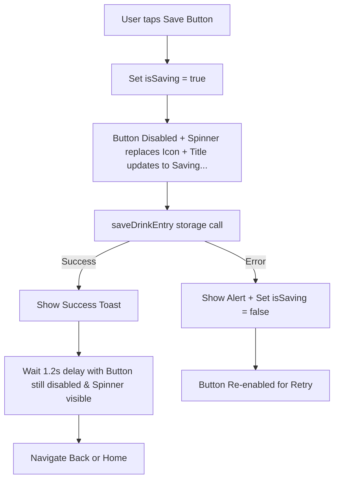

# Requirements

### Overview & Goals
When saving or updating a drink entry in Tasteney, the save button must be disabled to prevent duplicate submissions, and the static icon (`🔖` or `✓`) should be replaced with a small activity spinner while the save request and subsequent navigation/redirect are underway.

### Scope
- **In Scope:**
  - Updating the shared `Button` component (`tasteney/src/components/button.tsx`) so that setting `loading={true}` replaces the icon with a small `ActivityIndicator` while preserving the button label and disabling touch events.
  - Updating `handleSave` in `tasteney/src/app/new-entry.tsx` to keep `isSaving` active during the save call and the subsequent toast/redirect delay until navigation completes.
  - Adding timer cleanup on unmount for the redirect timeout.
- **Out of Scope:**
  - Modifying backend storage APIs or storage schemas.
  - Changing other unrelated buttons across the application.

### User Stories
- **As a user logging a drink entry**, I want the save button to be visibly disabled with a loading spinner replacing the icon while saving and redirecting, so that I have clear visual feedback that my entry is being saved and I cannot accidentally trigger duplicate submissions.

### Functional Requirements
- **Button Loading State:**
  - When `loading={true}` on `Button`, the button must be disabled and rendered with disabled styling (`opacity: 0.6`).
  - When `loading={true}`, a small `ActivityIndicator` must be rendered at the icon position instead of the static icon or symbol.
  - The button title (e.g., "Saving...", "Updating...", or custom title) must remain visible next to the spinner.
- **Save & Redirect Lifecycle:**
  - When the user presses the save button in `NewEntryScreen`, `isSaving` becomes `true`.
  - The save button displays the saving label ("Saving..." / "Wird gespeichert..." or "Updating..." / "Wird aktualisiert...") and the spinner.
  - The save button remains deactivated and shows the spinner during the 1200ms success toast delay until navigation is performed.
  - If saving fails, the button reverts to its enabled state (`isSaving` set to `false`) and displays an error alert so the user can retry.

# Technical Design

### Current Implementation
- In `tasteney/src/components/button.tsx`, passing `loading={true}` currently replaces the entire button content (`children` and `title`) with an `ActivityIndicator`, rather than keeping the label and replacing only the icon.
- In `tasteney/src/app/new-entry.tsx`, `handleSave` sets `setIsSaving(true)` and calls `saveDrinkEntry`. However, its `finally` block executes `setIsSaving(false)` immediately after scheduling the asynchronous 1200ms `setTimeout` for toast display and redirection, causing the button to prematurely re-enable and switch back to static icon and title before redirecting.

### Key Decisions
- **Icon Replacement in `Button`:** Update `renderIcon()` in `Button` to render `<ActivityIndicator size="small" color={variantStyle.iconColor} />` when `loading={true}`. This allows `Button` to display both the spinner and the title text across all variants and sizes.
- **Save State Retention:** In `NewEntryScreen`, keep `isSaving` `true` throughout the successful save and redirect window. In the event of a catch/error, reset `setIsSaving(false)` to allow retry.
- **Timer Lifecycle Management:** Store the redirect timer ID in a ref and clean up on component unmount to prevent state updates on unmounted screens.

### Architecture Diagram

### Proposed Changes
- **`tasteney/src/components/button.tsx`:**
  - Modify `renderIcon` to return `<ActivityIndicator size="small" color={variantStyle.iconColor} />` when `loading` is `true`.
  - Update the component's JSX structure so the spinner and title are rendered together rather than having `loading` conditionally bypass the title text.
- **`tasteney/src/app/new-entry.tsx`:**
  - Remove premature `setIsSaving(false)` from the `finally` block in `handleSave`.
  - Add `setIsSaving(false)` in the `catch` block on failure.
  - Manage redirect timeout with a cleanup ref.

### File Structure
- `tasteney/src/components/button.tsx` (Modified: update loading presentation to show spinner in icon slot)
- `tasteney/src/app/new-entry.tsx` (Modified: maintain isSaving throughout save and redirect lifecycle)

### Risks & Mitigations
- **Risk:** Fast unmounting or back navigation while timeout is active causing memory leaks or state update warnings.
  - **Mitigation:** Use a `useRef` to hold the timeout reference and clear it in a `useEffect` cleanup handler.
- **Risk:** Button without an icon when `loading={false}` does not show an icon, but should show spinner when `loading={true}`.
  - **Mitigation:** Ensure `renderIcon` returns the `ActivityIndicator` whenever `loading={true}`, regardless of whether an initial `icon` prop was provided.

# Testing

### Validation Approach
Verify the button loading state and save lifecycle across both creation and editing flows in `NewEntryScreen` as well as direct usage of the `Button` component.

### Key Scenarios
- **Create New Entry:**
  - Fill out mandatory fields on `/new-entry` and tap "Save Tasting Entry".
  - Verify that the button immediately disables, the bookmark icon `🔖` is replaced by a small spinner, and the title changes to "Saving...".
  - Verify that during the 1.2s success toast, the button stays disabled with the spinner showing.
  - Verify redirection to the diary or previous screen completes without duplicate taps possible.
- **Edit Existing Entry:**
  - Open an existing entry on `/new-entry?id=...` and tap "Update Tasting Entry".
  - Verify that the checkmark icon `✓` is replaced by a small spinner and the title changes to "Updating...".
  - Verify that the button stays disabled with spinner until redirect.
- **Save Failure / Error Handling:**
  - Simulate an error during save.
  - Verify that the error alert is shown and `isSaving` is reset to `false`, allowing the user to tap the save button again.

### Edge Cases
- **Fast Navigation / Unmount:** Navigating away during the redirect timeout does not throw unmounted component warnings.
- **Theme Consistency:** Spinner color matches `variantStyle.iconColor` (`colors.onPrimary`) in both light and dark modes.

# Delivery Steps

### ✓ Step 1: Update Button component to render spinner in place of icon during loading
The `Button` component will render a small `ActivityIndicator` in place of the button icon when `loading` is active, keeping the button title/children visible and disabling interactions.

- Update `renderIcon` in `tasteney/src/components/button.tsx` so that when `loading` is `true`, it returns an `<ActivityIndicator size="small" color={variantStyle.iconColor} />` instead of the static icon.
- Adjust the main render structure of `Button` to render the spinner in the icon position (`left` or `right`) alongside the title text/children rather than replacing the entire button contents.
- Ensure the button remains disabled with dimmed opacity (`(disabled || loading) && styles.disabled`) and non-clickable during loading.

### ✓ Step 2: Maintain saving state and disabled button through save and redirect in NewEntryScreen
The `NewEntryScreen` will keep `isSaving` active and the save button disabled with spinner and updating/saving label throughout the save operation and subsequent redirect delay.

- Update `handleSave` in `tasteney/src/app/new-entry.tsx` so `setIsSaving(false)` is only triggered on error, keeping `isSaving` set to `true` while the success toast is shown and navigation is queued.
- Track redirect timeout via a `useRef` to safely clean up pending timers on component unmount.
- Verify that the save button renders the localized "Saving..." / "Updating..." text alongside the active spinner until the route transition occurs.