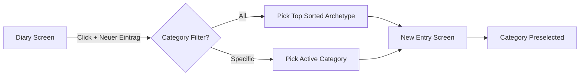

# Requirements

### Overview & Goals
To maximize user efficiency and minimize unnecessary interactions when recording new beverages, clicking the primary "+ Neuer Eintrag" button on the Diary screen should automatically preselect the first available category (the highest-priority category from the sorted list) rather than always defaulting statically to Wine. Additionally, to improve visual prominence and alignment with the app's aesthetic hierarchy, the "+ Neuer Eintrag" button will feature a yellow shadow utilizing the existing design palette tokens.

### Scope
- **In Scope:**
  - Dynamically passing the first sorted archetype category when triggering "+ Neuer Eintrag" from the "All" view on the Diary home screen.
  - Ensuring the entry creation screen (`tasteney/src/app/new-entry.tsx`) defaults to the first category in the sorted list when no specific category is explicitly passed.
  - Adding a yellow shadow to the "+ Neuer Eintrag" button in `tasteney/src/app/(tabs)/index.tsx` using the existing theme palette (`Colors.light` / `Colors.dark` `secondaryFixed` / `secondary`).
- **Out of Scope:**
  - Modifying entry persistence structure or storage interfaces.
  - Altering category ordering algorithms or sensory descriptor ranking logic.

### User Stories
- **As an active user logging frequent drinks**, I want the new entry screen to default to my top/first category instead of always forcing Wine, so that my entry workflow requires fewer taps and reduces cognitive friction.
- **As a user navigating the diary**, I want the "+ Neuer Eintrag" action button to have a prominent yellow accent shadow, so that the primary call-to-action is clear, visually appealing, and cohesive with the theme.

### Functional Requirements
- **Dynamic Category Defaulting:**
  - When "+ Neuer Eintrag" is pressed while filtering by "All", the new entry screen must open with the first category from the sorted category list selected.
  - When "+ Neuer Eintrag" is pressed while filtering by a specific category (e.g., Beer, Coffee), that specific category must remain preselected.
  - When opening `/new-entry` without parameters, the initial category must resolve dynamically to the first available category rather than hardcoded Wine.
- **Button Shadow Styling:**
  - The "+ Neuer Eintrag" button on the Diary home screen must render a yellow shadow using the existing theme tokens (`colors.secondaryFixed` / `colors.secondary`).
  - Shadow styling must remain visually balanced across light and dark color schemes.

# Technical Design

### Current Implementation
- **Category Selection:** In `tasteney/src/app/(tabs)/index.tsx`, when `selectedCategory === 'All'`, `handleAddNewEntry` pushes `/new-entry` without params. In `tasteney/src/app/new-entry.tsx`, `archetype` state defaults to a static `'Wine'` when `params.archetype` is not present.
- **Button Styling:** The button in `tasteney/src/app/(tabs)/index.tsx` uses `variant="container"` which applies default maroon shadow (`#4d0011`) defined in `Button.tsx`.

### Key Decisions
- **Palette Sourcing:** Use `colors.secondaryFixed` (or `colors.secondary`) from `tasteney/src/constants/theme.ts` for the button shadow to maintain complete consistency with the existing yellow/gold accent color palette across light and dark modes.
- **Preselection Strategy:**
  1. Forward `sortedArchetypes[0]` from `index.tsx` when `selectedCategory === 'All'`.
  2. In `new-entry.tsx`, replace the hardcoded fallback `'Wine'` with the first available archetype (`sortedArchetypes[0]?.label ?? ARCHETYPES[0].label`).

### Architecture Diagram

### Proposed Changes
- **`tasteney/src/app/(tabs)/index.tsx`:**
  - Update `handleAddNewEntry` to pass `sortedArchetypes[0]` when `selectedCategory === 'All'`.
  - Add custom yellow shadow styles to the "+ Neuer Eintrag" `Button` using `colors.secondaryFixed` / `colors.secondary`.
- **`tasteney/src/app/new-entry.tsx`:**
  - Update default `archetype` initial state and fallback resolution logic from hardcoded `'Wine'` to the leading item of `sortedArchetypes` / `ARCHETYPES`.

### File Structure
- `tasteney/src/app/(tabs)/index.tsx` (Modified: update button shadow & navigation handler)
- `tasteney/src/app/new-entry.tsx` (Modified: update default archetype fallback)

### Risks & Mitigations
- **Risk:** Empty entries list on initial launch where counts are all zero.
  - **Mitigation:** Fall back cleanly to the first item in the default archetype list (`ARCHETYPES[0].label`).

# Testing

### Validation Approach
Verify that the "+ Neuer Eintrag" button displays the yellow shadow correctly in both theme modes, and confirm that clicking it preselects the top category across all filter states.

### Key Scenarios
- **All Category Filter:** Click "+ Neuer Eintrag" on the Diary screen when "All" is active; verify the new entry form opens with the first category pill selected.
- **Specific Category Filter:** Select a category (e.g. "Coffee") on the Diary screen and click "+ Neuer Eintrag"; verify "Coffee" is preselected.
- **Button Visual Inspection:** Inspect "+ Neuer Eintrag" button in light and dark modes to verify the yellow shadow is applied cleanly.
- **Dynamic Reordering:** With drink entries logged under different categories, verify the top-ranked category on the home screen matches the preselected category in the new entry modal.

# Delivery Steps

### ✓ Step 1: Apply yellow shadow styling to the Add Entry button
The "+ Neuer Eintrag" button on the Diary home screen is styled with a distinct yellow shadow derived from the existing theme palette.

- Locate the `Button` component rendering `t('diary.addDrink')` in `tasteney/src/app/(tabs)/index.tsx`.
- Apply shadow properties (`shadowColor`, `shadowOffset`, `shadowOpacity`, `shadowRadius`, `elevation`) referencing the yellow palette token (`colors.secondaryFixed` / `colors.secondary`) from `Colors` in `tasteney/src/constants/theme.ts`.
- Ensure styling works consistently across light and dark color schemes as well as iOS, Android, and Web platforms.

### ✓ Step 2: Implement dynamic category preselection on entry creation
Clicking "+ Neuer Eintrag" and navigating to the entry creation screen automatically selects the top-ranked category rather than defaulting unconditionally to Wine.

- Update `handleAddNewEntry` in `tasteney/src/app/(tabs)/index.tsx` so that when `selectedCategory === 'All'`, it extracts the leading category from `sortedArchetypes[0]` and forwards it in `params.archetype`.
- Update archetype state initialization and synchronization in `tasteney/src/app/new-entry.tsx` so that fallback values use the leading item of `sortedArchetypes` (or the first archetype definition) rather than a hardcoded `'Wine'`.
- Verify that custom user selections and explicit route parameters from specific category filters continue to be respected without regression.