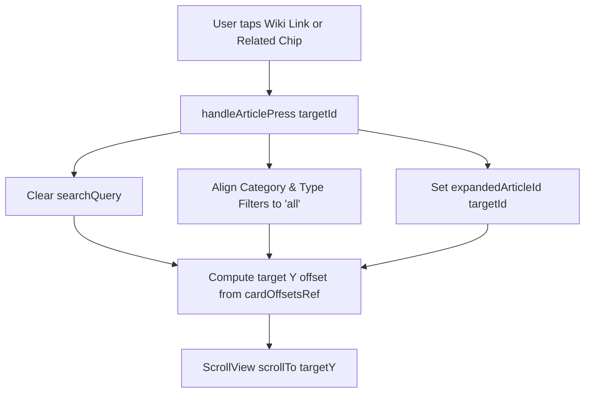

# Requirements

### Overview & Goals
The goal of this enhancement is to deliver a frictionless knowledge exploration experience in the Explore tab. When a user taps an inline wiki link or a related article chip, the application will automatically ensure the destination article is visible by clearing/aligning filter criteria (search query, category, article type), expanding the article, and scrolling smoothly to its position on the screen. Additionally, the related articles cross-reference chips will be constrained to prevent overflowing their container box on narrow viewports or with lengthy article titles.

### Scope
- **In Scope**:
  - Auto-adjusting filter criteria (clearing search query, resetting mismatched category and article type filters) upon link click.
  - Tracking layout coordinates of individual article cards and scrolling the main `ScrollView` directly to the target element.
  - Expanding the target article card upon navigation.
  - Fixing flexbox and width constraints on `.relatedArticlesBox`, `.relatedChipsWrap`, `.relatedChipButton`, and `.relatedChipText` in `src/app/(tabs)/explore.tsx`.
- **Out of Scope**:
  - Modifying backend data services or article knowledge data structures.
  - Changing routing away from the Explore screen (external Wikipedia links remain handled by standard system browser).

### User Stories
- As a user browsing drink knowledge, I want clicking a linked term or related article to immediately navigate and scroll to that article so that I can seamlessly explore connected concepts without losing context.
- As a user with active search or category filters, I want filter constraints automatically relaxed when I click an article link so that the target article is always visible.
- As a user on a mobile device, I want related article link boxes to fit neatly inside their parent container without overflowing or clipping awkwardly.

### Functional Requirements
- **FR-1: Filter Criteria Alignment on Link Press**: When `handleArticlePress(targetId)` is invoked:
  - If a search query is active (`searchQuery !== ''`), it must be cleared.
  - If `selectedCategory` does not match the target article's category, `selectedCategory` must be reset to `'all'`.
  - If `selectedArticleType` does not match the target article's type, `selectedArticleType` must be reset to `'all'`.
  - The target article must be set as expanded (`expandedArticleId = targetId`).
- **FR-2: Target Element Scrolling**: The view must smoothly scroll to the Y-position of the target article card within the `ScrollView`.
- **FR-3: Container Boundary Containment**: Related article chips in the related articles section must not exceed 100% width of the `.relatedArticlesBox` container, allowing text wrapping and flexible shrinking for long titles.

# Technical Design

### Current Implementation
- **File**: `src/app/(tabs)/explore.tsx`
- **Filter State**: Controlled by `selectedCategory`, `selectedArticleType`, and `searchQuery`.
- **Link Handling**: `handleArticlePress` resets `selectedCategory` and `selectedArticleType` to `'all'` if mismatched, sets `expandedArticleId`, and calls `scrollViewRef.current?.scrollTo({ y: 0, animated: true })` which scrolls to the top of the entire page rather than the target card. If a `searchQuery` is active, the article remains hidden if the search term does not match.
- **Related Articles Layout**: `.relatedChipsWrap` uses `flexDirection: 'row'`, `flexWrap: 'wrap'`, but child `.relatedChipButton` lacks `maxWidth: '100%'` and `.relatedChipText` lacks `flexShrink: 1`, allowing long titles (e.g., German translations with compound words or parentheticals) to push the button past the right boundary of `.relatedArticlesBox`.

### Key Decisions
- **Offset Tracking via Card Layout Refs**: Maintain a `cardOffsetsRef` dictionary mapping `articleId -> number` populated via `onLayout` on each card container, alongside a `listOffsetYRef` tracking the header offset. This provides instantaneous, performant scroll targets without heavy re-renders.
- **Scheduled Smooth Scroll**: Execute `scrollTo({ y: targetOffset, animated: true })` inside a post-layout / `requestAnimationFrame` tick to ensure layout stability when filter changes unmount or expand elements.
- **Defensive Flex Constraints**: Apply `maxWidth: '100%'`, `flexShrink: 1`, and text wrapping to `.relatedChipButton` and `.relatedChipText` to guarantee UI integrity across any screen dimension.

### Proposed Changes
- In `src/app/(tabs)/explore.tsx`:
  - Add `cardOffsetsRef` and `listOffsetYRef` refs.
  - In `handleArticlePress`:
    - Reset `searchQuery` to `''`.
    - Reset mismatched category/type filters to `'all'`.
    - Set `expandedArticleId(targetId)`.
    - Compute target scroll offset: `(listOffsetYRef.current || 0) + (cardOffsetsRef.current[targetId] || 0)`.
    - Execute `scrollViewRef.current?.scrollTo({ y: Math.max(0, targetOffset - Spacing.two), animated: true })`.
  - In `renderArticleCard`:
    - Attach `onLayout={(e) => { cardOffsetsRef.current[article.id] = e.nativeEvent.layout.y; }}` to the root card `View`.
  - In `styles`:
    - Update `relatedChipButton` with `maxWidth: '100%'` and `flexShrink: 1`.
    - Update `relatedChipText` with `flexShrink: 1`.
    - Update `relatedArticlesBox` with `overflow: 'hidden'`.

### Architecture Diagram

# Testing

### Validation Approach
Verification focuses on maximizing navigation reliability, preventing UI truncation, and ensuring smooth auto-scrolling across all device form factors.

### Key Scenarios
- **Scenario 1: Inline Link Navigation with Active Filters**:
  - Filter articles by a specific category (e.g., 'Cocktails') or enter a search query (e.g., 'Martini').
  - Tap an inline wiki link pointing to an article outside the current filter (e.g., 'Islay Scotch' or 'Torffeuern').
  - Verify filters and search queries reset, the destination article becomes visible and expanded, and the scroll view scrolls directly to that card.
- **Scenario 2: Related Article Chip Navigation**:
  - Open an expanded article and tap one of the chips in the 'Related Articles' section.
  - Verify the target article is expanded and scrolled into direct view.
- **Scenario 3: Long Title Wrap in Related Articles Box**:
  - Open articles containing long related titles in both English and German locales.
  - Verify chips never overflow the right edge of `.relatedArticlesBox` on compact screen widths (e.g., 320px–375px viewports).

### Edge Cases
- Target article already at top vs. at the bottom of the list.
- Rapid successive link clicking.
- Missing target article ID gracefully handled without exceptions.

# Delivery Steps

### ✓ Step 1: Implement dynamic filter adjustment and element auto-scrolling on link click
Target article link clicks reliably reset blocking filters and scroll directly to the selected article.

- Introduce a ref mapping (`cardPositionsRef`) and header/container offset tracking to record precise Y-coordinates of article cards during layout.
- Update `handleArticlePress` in `src/app/(tabs)/explore.tsx` to clear active search queries (`searchQuery`) and adjust category / type filters (`selectedCategory`, `selectedArticleType`) so the destination article is never filtered out.
- Set the target article as expanded (`setExpandedArticleId`) and trigger smooth vertical scrolling to the target card position in `ScrollView` across native and web platforms.

### ✓ Step 2: Fix layout constraints and overflow prevention for related article link boxes
Related article link boxes wrap and shrink properly within their container without horizontal overflow.

- Update `styles.relatedChipButton` with `maxWidth: '100%'` and `flexShrink: 1` to prevent buttons from extending past the bounding container.
- Update `styles.relatedChipText` with `flexShrink: 1` and text wrapping to gracefully handle long article titles.
- Refine `styles.relatedArticlesBox` and `styles.relatedChipsWrap` with robust flex wrapping, boundary clipping, and responsive spacing.

### ✓ Step 3: Validate link navigation, scrolling accuracy, and responsive layout
The Explore tab delivers seamless, verified navigation across inline links and related article chips under all filter states.

- Validate cross-referencing from inline wiki links (`LinkedArticleContent`) and related article chips when filtered by search query, category, or article type.
- Verify smooth auto-scroll positioning when expanding articles of varying heights and metadata configurations.
- Verify chip boundary containment and text wrapping on mobile screen widths and localized German/English article titles.