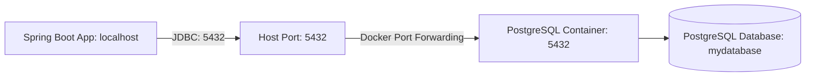

# Requirements

### Overview & Goals
Resolve the database connection failure (`PSQLException: Connection to localhost:5432 refused`) by exposing container port 5432 to the host system and ensuring Spring Boot activates the appropriate datasource configuration for local development.

### Scope
#### In Scope
- Correcting Docker Compose port publication in `tasteney-be/compose.yaml` from `'5432'` to `'5432:5432'`.
- Ensuring `tasteney-be/src/main/resources/application.properties` activates the `DEV` profile or specifies default local datasource credentials matching `compose.yaml`.
- Verifying end-to-end connection between Spring Boot / Flyway and PostgreSQL.

#### Out of Scope
- Production database provisioning and cloud infrastructure setup.
- Modifying database schema migrations in `src/main/resources/db/migration/`.

### Functional Requirements
- PostgreSQL container must bind and listen on host port `5432` when started via `docker compose up -d`.
- Spring Boot application started locally (`./mvnw spring-boot:run`) must connect to `localhost:5432` without manual JDBC override parameters.
- Flyway database migrations and initial admin account seeding must execute successfully upon connection establishment.

# Technical Design

### Current Implementation
- `tasteney-be/compose.yaml` defines the PostgreSQL service with `ports: - '5432'`. In Docker Compose, specifying a single port exposes it on a random ephemeral host port rather than binding to host port 5432.
- `tasteney-be/src/main/resources/application.properties` disables Spring Docker Compose integration (`spring.docker.compose.enabled=false`) but does not set an active profile or default datasource URL.
- `tasteney-be/src/main/resources/application-DEV.properties` defines the required local connection details (`jdbc:postgresql://localhost:5432/mydatabase`, user `myuser`, password `secret`).
- When the host Spring Boot application boots up, HikariCP attempts to connect to `localhost:5432`, failing with `Connection to localhost:5432 refused`.

### Key Decisions
- **Explicit Host Port Binding**: Bind container port 5432 directly to host port 5432 (`'5432:5432'`) in `compose.yaml` to ensure direct access from host processes and development tooling.
- **Default Profile Activation**: Set `spring.profiles.active=DEV` in `application.properties` so developers running `./mvnw spring-boot:run` connect out-of-the-box without extra CLI arguments.

### Proposed Changes
- In `tasteney-be/compose.yaml`, update `ports` under `postgres` to `- '5432:5432'`.
- In `tasteney-be/src/main/resources/application.properties`, add `spring.profiles.active=DEV`.

### Architecture Diagram

### Risks
- **Host Port Conflict**: If another local PostgreSQL instance is running on port 5432, Docker Compose will fail to bind the port. Mitigation: ensure no other local PostgreSQL daemon is bound to 5432 before starting the container.

# Testing

### Validation Approach
Verify that the port mapping is active on the Docker daemon and that Spring Boot can establish a JDBC connection, run Flyway migrations, and start without exceptions.

### Key Scenarios
- **Docker Port Mapping Verification**: Running `docker compose ps` shows `0.0.0.0:5432->5432/tcp`.
- **Application Boot & DB Connection**: Running `./mvnw spring-boot:run` in `tasteney-be/` establishes connection to PostgreSQL, runs Flyway migrations in `src/main/resources/db/migration/`, seeds initial admin user, and starts the web server on port 8080.
- **Backend Test Suite Integrity**: Running `./mvnw test` continues to succeed using the in-memory H2 configuration defined for tests.

### Regressions to Prevent
- Breaking test isolation: ensure tests continue using `src/test/resources/application.properties` (H2 database) without depending on an active Docker container.

# Delivery Steps

### ✓ Step 1: Configure Docker Compose host port mapping for PostgreSQL
The PostgreSQL container in `compose.yaml` explicitly maps port 5432 on the host machine to port 5432 in the container.

- Update `tasteney-be/compose.yaml` port mapping under the `postgres` service from `'5432'` to `'5432:5432'`.
- Ensure PostgreSQL binds to host interface `localhost:5432` so local processes can establish TCP connections.

### ✓ Step 2: Align Spring Boot datasource and active profile configuration
The Spring Boot application automatically resolves the local PostgreSQL datasource credentials upon startup.

- Configure `spring.profiles.active=DEV` in `tasteney-be/src/main/resources/application.properties` (or align default datasource properties with `compose.yaml` values: `jdbc:postgresql://localhost:5432/mydatabase`, username `myuser`, password `secret`).
- Verify that `spring.docker.compose.enabled=false` and Flyway migration configurations continue functioning reliably during startup.

### * Step 3: Restart container and verify end-to-end database connectivity
The containerized database and backend application establish a verified end-to-end connection and complete database schema migrations.

- Restart the Docker Compose container (`docker compose down && docker compose up -d`) to apply the port publication.
- Execute `./mvnw clean compile` and run the Spring Boot application (or test database connection) to verify Flyway migrations apply and HikariCP successfully connects without connection refused errors.