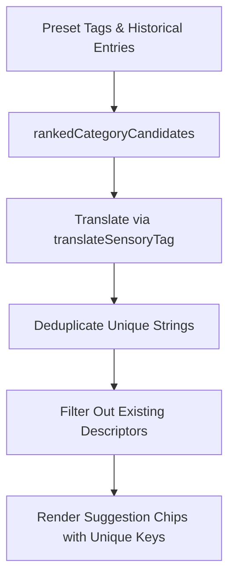

# Requirements

### Overview & Goals
When creating or editing a drink entry in the app, users encounter a React duplicate key error: `"Encountered two children with the same key, Warme Eiche & Würze"`. This occurs because default presets in English (e.g. `'Warm Oak & Spice'`) and user-saved tags in German (e.g. `'Warme Eiche & Würze'`) both resolve to the same localized label `'Warme Eiche & Würze'` when suggestions are rendered in `SensorySelector`, causing duplicate sibling elements with identical `key` values.

The goal is to eliminate this error, ensure clean deduplication across localized and raw preset names, and maximize user satisfaction by providing a frictionless and bug-free sensory tasting note workflow.

### Scope
- **In Scope**:
  - `tasteney/src/components/sensory-selector.tsx`:
    - Deduplicating suggestion presets across raw and translated strings.
    - Updating existing descriptor checks in `existingNames`, `hasExactMatch`, and `addTag` to be translation-aware.
    - Ensuring React keys for suggestion chips are unique and resilient against duplicates.
- **Out of Scope**:
  - Modifying translation dictionaries or underlying database schemas.
  - Changes to rating or image selection logic.

### User Stories
- As a user logging drinks in German or English, I want to add aroma and flavor descriptors without seeing React duplicate key errors or redundant suggestion buttons, so that the tasting entry experience is smooth, reliable, and delightful.

### Functional Requirements
- **FR-1**: When suggestions are computed for a sensory category (Smell, Taste, Aftertaste), each suggested descriptor label must appear at most once.
- **FR-2**: If a descriptor is already attached to the current drink (in either English or German), it must be excluded from the suggestion chips.
- **FR-3**: Adding a custom or preset tag that matches an existing tag by translation must be treated as already present, preventing duplicate items in the drink's sensory list.
- **FR-4**: React keys in rendered suggestion lists must remain strictly unique.

# Technical Design

### Current Implementation
In `tasteney/src/components/sensory-selector.tsx`:
1. `rankedCategoryCandidates` merges default presets from `ARCHETYPE_SENSORY_PRESETS` and historical user tags from `entries`. It combines them by comparing lowercase untranslated strings: `p.toLowerCase() === uTag.toLowerCase()`.
2. If `entries` contains a German tag `'Warme Eiche & Würze'` and the preset contains `'Warm Oak & Spice'`, both strings are added to the candidate list.
3. During rendering, `candidateTags.map((preset) => translateSensoryTag(preset))` converts both items to `'Warme Eiche & Würze'`.
4. The resulting `matchingPresets` array contains two identical `'Warme Eiche & Würze'` elements.
5. In the JSX, `{matchingPresets.map((preset) => <TouchableOpacity key={preset} ...>)}` renders two sibling elements with `key="Warme Eiche & Würze"`, triggering the React error.

### Key Decisions
- **Translation-Aware Deduplication**: Deduplicate suggestion candidates after translation mapping so identical localized strings are reduced to a single unique item before slicing and rendering.
- **Bi-directional Existence Check**: When checking `existingNames`, evaluate both the raw name `d.name` and the translated name `translateSensoryTag(d.name)` to prevent offering or adding duplicate descriptors across different language representations.
- **Defensive React Keys**: Ensure mapped suggestion elements use unique composite keys (e.g. `key={`suggestion-${category}-${preset}-${idx}`}`) as defense-in-depth against unexpected runtime collisions.

### Proposed Changes
1. **`tasteney/src/components/sensory-selector.tsx`**:
   - In `rankedCategoryCandidates`: Normalize tags by checking if localized versions or canonical preset versions match before inserting.
   - In `matchingPresets` calculation:
     - Expand `existingNames` to include both raw and translated names of all descriptors currently in `categoryDescriptors`.
     - Filter candidates against `existingNames` and search query.
     - Deduplicate the resulting array (e.g. via `Array.from(new Set(...))`) before slicing to the top 4 suggestions.
   - In `addTag`: Update duplicate check to match either `d.name.toLowerCase() === trimmed.toLowerCase()` or `translateSensoryTag(d.name).toLowerCase() === translateSensoryTag(trimmed).toLowerCase()`.
   - In `showCustomOption` / `hasExactMatch`: Match against both localized and unlocalized strings.
   - In JSX suggestions map: Use guaranteed unique items and composite keys.

### Architecture Diagram

### Risks & Mitigations
- *Risk*: Presets or user tags could be dropped if translation collapses distinct tags into the same text.
  *Mitigation*: The translation dictionary maps distinct 1-to-1 terms; deduplicating identical translated labels is the correct UX behavior since the user sees identical text.

# Testing

### Validation Approach
Verify that the duplicate key error is resolved and that the sensory descriptor suggestions and tag addition work seamlessly across languages and archetypes.

### Key Scenarios
1. **German Locale with Presets and Previous Entries**:
   - Create entries with German sensory tags such as "Warme Eiche & Würze".
   - Open New Entry screen and observe the Aftertaste category presets and suggestions.
   - Verify that "Warme Eiche & Würze" appears exactly once with no React duplicate key warnings.
2. **Selecting a Preset**:
   - Click "+ Warme Eiche & Würze".
   - Verify the tag is added to the category list and immediately disappears from the suggestion chips.
3. **Custom Tag Collision Prevention**:
   - Type "Warme Eiche & Würze" or "Warm Oak & Spice" in the search box.
   - Verify that exact match detection prevents redundant custom tag options when the descriptor is already present.
4. **Different Archetypes (Wine, Spirits, Coffee, Beer, etc.)**:
   - Switch between beverage archetypes and verify all category suggestions render cleanly without duplicate keys.

# Delivery Steps

### ✓ Step 1: Update sensory descriptor deduplication and translation normalization
Sensory preset aggregation and tag addition logic are made translation-aware and prevent duplicate descriptors.

- Update `rankedCategoryCandidates` in `sensory-selector.tsx` to normalize and deduplicate user tags against default archetype presets, accounting for both English keys and localized translations.
- Update `addTag` in `sensory-selector.tsx` to check for existing descriptors comparing both raw names and translated labels (`translateSensoryTag`), preventing duplicate additions under different locales.
- Update `hasExactMatch` and `showCustomOption` checks to accurately recognize when an input matches an existing descriptor or preset across languages.

### ✓ Step 2: Harden suggestion filtering, uniqueness deduplication, and React key rendering
Suggestion chips in the sensory selector are strictly unique and safely keyed.

- Refactor `matchingPresets` computation in `sensory-selector.tsx` to filter out already added descriptors (matching raw and translated names) and deduplicate mapped strings so each suggestion appears at most once.
- Update the suggestions rendering loop to assign robust, unique React keys (combining category, preset, and index) to prevent any key collisions in React runtime.
- Verify that adding descriptors in various locales (e.g., German 'Warme Eiche & Würze' and English 'Warm Oak & Spice') produces no console errors or duplicate suggestion chips.