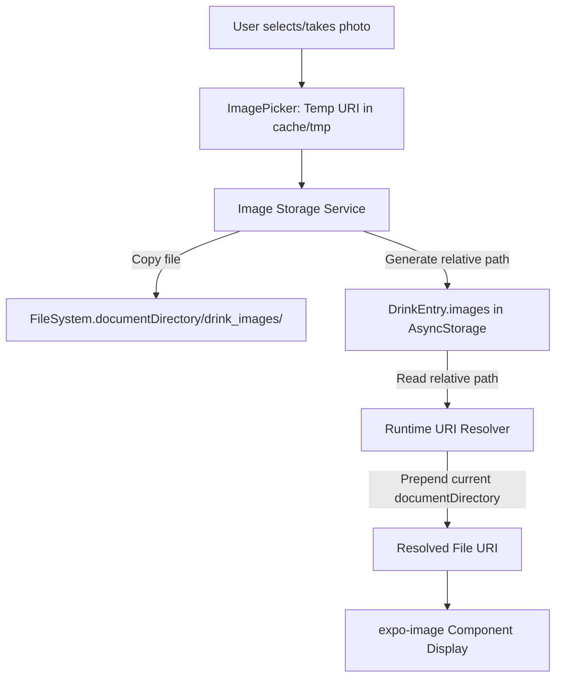

# Requirements

### Overview & Goals
When running the app on iOS via TestFlight (or during app updates/reinstalls), images previously attached to drink entries disappear. The goal of this task is to diagnose the root cause, establish a persistent local image storage pipeline, and ensure drink images remain accessible across app updates, device restarts, and OS cache cleanups.

### Root Cause Analysis
1. **iOS Sandbox Container UUID Invalidation**: On iOS, every application is assigned a sandboxed container directory (`/var/mobile/Containers/Data/Application/<UUID>/`). Whenever an app is updated via TestFlight or the App Store, iOS generates a new UUID. Absolute file URIs stored as strings (e.g. `file:///var/mobile/.../<OLD-UUID>/...`) immediately become dead links.
2. **Temporary / Cache Directory Eviction**: `expo-image-picker` stores newly captured or picked photos in the system temporary/cache directory (`tmp` or `Library/Caches`). The operating system automatically purges these files when disk space is constrained or during app restarts.
3. **No Local File Persistence**: The application currently takes raw temporary URIs directly from `ImagePicker` and stores them in `AsyncStorage` without copying the actual image files to the app's persistent document directory (`FileSystem.documentDirectory`).

### Scope
- **In Scope**:
  - Adding `expo-file-system` to provide persistent file operations.
  - Creating a dedicated Image Storage Service (`src/services/image-storage.ts`) to manage saving, resolving, and deleting local drink images.
  - Updating `src/services/storage.ts` to persist images into `documentDirectory` and store only relative paths in `AsyncStorage`.
  - Dynamically resolving stored relative paths to absolute container URIs at runtime.
  - Backward compatibility logic to gracefully handle legacy absolute paths and fallback images.
  - Updating entry creation/editing (`src/app/new-entry.tsx`), detail view (`src/app/entry-detail.tsx`), diary list (`src/app/(tabs)/index.tsx`), and `src/components/image-selector.tsx`.
- **Out of Scope**:
  - Remote cloud image hosting / S3 upload (the app currently operates offline-first using local storage).

### User Stories
- As a user, I want my captured drink photos to remain permanently saved in my journal even after updating the app via TestFlight or restarting my device.
- As a user, I want to edit or delete drink entries without leaving orphaned image files that take up unnecessary device storage.

# Technical Design

### Current Implementation
- `src/components/image-selector.tsx` captures image URIs directly from `ImagePicker.launchImageLibraryAsync` or `ImagePicker.launchCameraAsync` and emits raw absolute URIs (e.g., `file:///var/mobile/.../tmp/xyz.jpg`).
- `src/app/new-entry.tsx` passes these raw URIs directly into `saveDrinkEntry`.
- `src/services/storage.ts` serializes the raw URIs directly into `@react-native-async-storage/async-storage` (`@tasteney/drink_entries_v1`).
- `package.json` does not yet include `expo-file-system`.

### Key Decisions
1. **Store Relative Paths in AsyncStorage, Resolve at Runtime**:
   - *Decision*: Only store relative filenames/subpaths (e.g., `drink_images/img_1710000000_abc123.jpg`) in `DrinkEntry.images`.
   - *Rationale*: Because the iOS sandbox container UUID changes on every app build/update, absolute paths must never be hardcoded in persistent storage. Constructing the absolute path at runtime using `FileSystem.documentDirectory` ensures paths remain valid regardless of container UUID changes.
2. **Dedicated Image Directory**:
   - *Decision*: Store all persistent images under `${FileSystem.documentDirectory}drink_images/`.
   - *Rationale*: Isolates app media for clean directory management, migration, and disk cleanup.
3. **Automatic Orphan Cleanup on Deletion / Edit**:
   - *Decision*: When an entry is deleted or an existing entry removes an image, delete the physical file from `drink_images/`.

### Architecture Diagram

### Proposed Changes & File Structure

#### 1. `package.json`
- Add `expo-file-system: "~57.0.20"` (matching the Expo SDK version).

#### 2. `src/services/image-storage.ts` (New File)
- **`ensureDirectoryExists()`**: Creates `${FileSystem.documentDirectory}drink_images/` if it does not exist.
- **`persistImage(uri: string): Promise<string>`**:
  - Checks if URI is already relative or already stored in `drink_images/`.
  - If it is a temporary URI or external file URI, copies it into `${FileSystem.documentDirectory}drink_images/img_${Date.now()}_${random}.jpg`.
  - Returns the relative path (e.g., `drink_images/img_...jpg`).
- **`resolveImageUri(storedUri: string | null | undefined): string | null`**:
  - If null/empty, returns null.
  - If starts with `http://`, `https://`, or `data:`, returns as-is.
  - If it is a legacy absolute path containing `drink_images/` or a file name, attempts to resolve with the current `FileSystem.documentDirectory`.
  - If relative path, prepends `FileSystem.documentDirectory`.
- **`deleteImageFile(storedUri: string): Promise<void>`**:
  - Resolves path and deletes file from disk via `FileSystem.deleteAsync`.

#### 3. `src/services/storage.ts`
- In `saveDrinkEntry`: iterate over `entryData.images` and call `persistImage(imgUri)` before saving to `AsyncStorage`.
- In `getDrinkEntries` and `getDrinkEntryById`: call `resolveImageUri` for each image so consumer components always receive ready-to-render valid URIs.
- In `deleteDrinkEntry`: find existing entry and call `deleteImageFile` for all its images.

#### 4. `src/components/image-selector.tsx` & `src/app/new-entry.tsx`
- Ensure temporary picker previews and saved entry images are properly displayed and passed through the persistence pipeline.
- Preserve unchanged images when editing an existing entry.

#### 5. `src/app/(tabs)/index.tsx` & `src/app/entry-detail.tsx`
- Ensure image rendering uses resolved URIs with fallback to archetype defaults if an image fails to load.

### Risks & Mitigations
- **Existing entries with broken paths**: Old entries saved prior to the fix will have dead paths. *Mitigation*: The resolver gracefully handles missing files and falls back to `getArchetypeFallbackImage(entry.archetype)` instead of crashing.
- **Web compatibility**: On web, `FileSystem.documentDirectory` may not be available. *Mitigation*: In web environments (`Platform.OS === 'web'`), bypass file copying and keep base64 or blob URIs as supported by web.

# Testing

### Validation Approach
Verify that:
1. New drink entries save images to persistent storage.
2. Saved images reload correctly across app reloads and when simulated container paths change.
3. Editing an entry keeps existing persistent images intact.
4. Deleting an entry removes both the entry from `AsyncStorage` and the image file from local storage.
5. Legacy entries or broken URIs fall back gracefully to archetype fallback images.

### Key Scenarios
- **Scenario 1: Add new drink with photo**
  - Take photo with camera or choose from gallery.
  - Save entry.
  - Verify image is copied into `FileSystem.documentDirectory + 'drink_images/'`.
  - Verify AsyncStorage stores only relative path.
  - Verify image renders in list view and detail view.

- **Scenario 2: Container UUID Change Simulation**
  - Save an entry with an image.
  - Verify that resolving the image at runtime uses the active `FileSystem.documentDirectory`, confirming that sandbox container UUID shifts do not invalidate the image.

- **Scenario 3: Edit existing drink**
  - Open existing entry in edit mode.
  - Add an additional photo and remove an old photo.
  - Save entry and confirm both images list and disk files are updated correctly.

- **Scenario 4: Delete drink entry**
  - Delete an entry containing photos.
  - Confirm entry is removed from list and associated files are deleted from the `drink_images` directory.

# Delivery Steps

### ✓ Step 1: Add expo-file-system and implement image storage service
Persistent file system storage is configured and image helper utilities are available across the app.

- Add `expo-file-system` to `package.json` dependencies.
- Create `src/services/image-storage.ts` to manage the app's dedicated persistent image folder in `FileSystem.documentDirectory`.
- Implement `persistImage(temporaryUri: string): Promise<string>` to copy images from temporary picker/camera paths into persistent document storage and return a relative path.
- Implement `resolveImageUri(storedUri: string | null | undefined): string | null` to dynamically map relative filenames to the current app container's document directory at runtime.
- Implement `deleteImageFile(storedUri: string): Promise<void>` to clean up orphaned image files when entries are deleted.

### ✓ Step 2: Integrate persistent image handling into drink entry storage
The drink entry storage service persists images to the document directory and resolves relative image paths on retrieval.

- Update `saveDrinkEntry` in `src/services/storage.ts` to process all incoming image URIs through `persistImage` so only relative filenames/paths are saved to `AsyncStorage`.
- Update `getDrinkEntries` and `getDrinkEntryById` in `src/services/storage.ts` to resolve stored image paths with `resolveImageUri` before returning entries to callers.
- Update `deleteDrinkEntry` in `src/services/storage.ts` to delete associated local image files from disk to prevent storage leaks.
- Add migration/recovery logic for legacy entries containing absolute paths from previous versions.

### ✓ Step 3: Update UI components and entry screens
All UI screens and components correctly preview, save, display, and delete images using persistent storage.

- Update `src/components/image-selector.tsx` to handle temporary preview URIs during entry creation/editing and integrate with image persistence.
- Update `src/app/new-entry.tsx` to save entries with persistent image management and handle existing images correctly in edit mode.
- Update `src/app/(tabs)/index.tsx` (journal feed) and `src/app/entry-detail.tsx` (detail hero & gallery) to ensure resolved image URIs display properly with graceful fallback to archetype images on load errors.