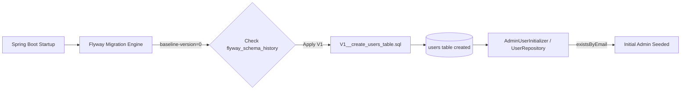

# Requirements

### Overview & Goals
Resolve the runtime database error `org.postgresql.util.PSQLException: ERROR: relation "users" does not exist` when starting the backend service (`tasteney-be`) against PostgreSQL. Ensure that Flyway migrations reliably create the `users` table on startup and that `AdminUserInitializer` can bootstrap the initial administrator account.

### Scope
#### In Scope
- Correcting Flyway baseline configuration in `tasteney-be/src/main/resources/application.properties` (`spring.flyway.baseline-version=0`).
- Documenting and executing database schema reset procedures for local Docker Compose environments.
- Verifying end-to-end startup with Flyway migration `V1__create_users_table.sql` and `AdminUserInitializer`.

#### Out of Scope
- Modifying entity contracts in `User.kt` or `UserRepository.kt` (schema and mapping already match).
- Changing test database configuration (`src/test/resources/application.properties` uses in-memory H2 and already succeeds).

### Functional Requirements
- **FR-1**: When `tasteney-be` starts against PostgreSQL, Flyway must automatically apply `V1__create_users_table.sql` if the `users` table does not exist.
- **FR-2**: Flyway baseline configuration must not skip `V1` migrations on existing or pre-initialized databases.
- **FR-3**: `AdminUserInitializer` must query and seed `admin-001@tasteney.com` without encountering missing relation errors.

# Technical Design

### Current Implementation & Root Cause Analysis
In `tasteney-be/src/main/resources/application.properties`, Flyway is configured with:
```properties
spring.flyway.enabled=true
spring.flyway.locations=classpath:db/migration
spring.flyway.baseline-on-migrate=true
```
When `spring.flyway.baseline-on-migrate=true` is enabled without specifying `spring.flyway.baseline-version=0`, Flyway defaults the baseline version to `1`. If PostgreSQL already contains any tables (such as session tables, metadata, or stale state from prior runs) when Flyway first runs without a `flyway_schema_history` table, Flyway marks the database as baselined at version `1`. Consequently, Flyway assumes `V1__create_users_table.sql` has already been applied and skips executing it.

When `AdminUserInitializer` runs during Spring Boot application startup (`ApplicationRunner`), it calls `userRepository.existsByEmail("admin-001@tasteney.com")`. Since `V1` was skipped and the table was never created, PostgreSQL throws:
```
Caused by: org.postgresql.util.PSQLException: ERROR: relation "users" does not exist
```

### Key Decisions
1. **Set Baseline Version to 0**: Configure `spring.flyway.baseline-version=0` in `application.properties`. If baseline-on-migrate triggers on a pre-existing schema, it will baseline at version `0`, allowing `V1__create_users_table.sql` to execute.
2. **Clean Docker Volume Reset for Local Development**: Provide clear steps to recreate the local PostgreSQL container volume (`docker compose down -v && docker compose up -d`) to eliminate stale `flyway_schema_history` records that previously skipped `V1`.

### Proposed Changes
- In `tasteney-be/src/main/resources/application.properties`:
  - Add `spring.flyway.baseline-version=0`.
- In local development environment:
  - Re-run Docker Compose with volume prune (`docker compose down -v && docker compose up -d`).
  - Start application with `./mvnw spring-boot:run`.

### Architecture Diagram


### Risks
- **Stale Schema History in Existing Container**: If the container already has `flyway_schema_history` with version `1` recorded as `BASELINE`, changing configuration alone won't re-run V1 unless the history table is cleaned or the container volume is recreated.
  - *Mitigation*: Reset local database volume via `docker compose down -v`.

# Testing

### Validation Approach
Verify that Flyway migration logs show successful migration application and that the backend boots up cleanly without database errors.

### Key Scenarios
- **Scenario 1: Fresh Database Initialization**
  - Given a fresh PostgreSQL container (`docker compose up -d`), starting `./mvnw spring-boot:run` applies `V1__create_users_table.sql`, creates the `users` table, and provisions `admin-001@tasteney.com`.
- **Scenario 2: Automated Test Suite**
  - Running `./mvnw test` executes all Modulith and integration tests against H2 with zero failures.

# Delivery Steps

### ✓ Step 1: Configure Flyway baseline version and migration settings in application properties
The Flyway baseline configuration in `application.properties` prevents skipping initial version 1 migrations.

- Update `tasteney-be/src/main/resources/application.properties` to set `spring.flyway.baseline-version=0` and ensure baseline settings do not mark `V1` as already applied on non-empty databases.
- Align `application-DEV.properties` and verify Flyway location (`classpath:db/migration`) and enabled status.

### * Step 2: Reset local PostgreSQL schema and validate Flyway migration execution
The PostgreSQL Docker container schema is reset and the backend application successfully runs Flyway migrations and initial user bootstrap.

- Reset the local Docker Compose PostgreSQL volume (`docker compose down -v && docker compose up -d`) to clear any stale or baselined schema history.
- Run `./mvnw spring-boot:run` to verify that Flyway executes `V1__create_users_table.sql`, creates the `users` table, and allows `AdminUserInitializer` to seed the admin account without `PSQLException`.
- Execute `./mvnw test` to ensure test suite and Spring Modulith verification remain green.