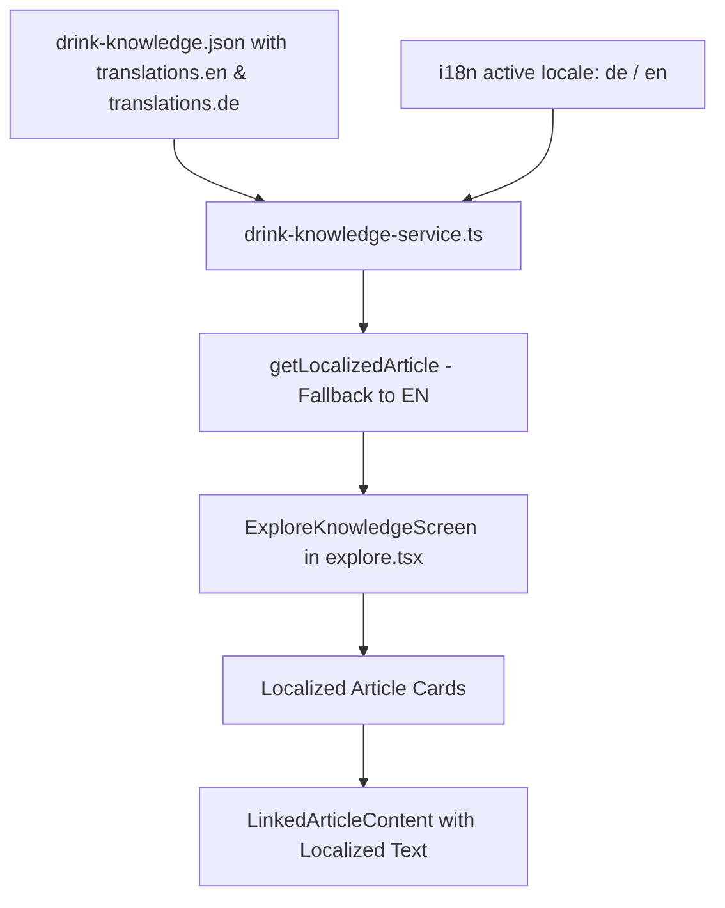

# Requirements

### Overview & Goals
The objective is to maximize the utility and educational value of the Drink-Knowledge encyclopedia page (`src/app/(tabs)/explore.tsx`) by introducing structured multilingual support directly within `src/data/drink-knowledge.json`. Beverage enthusiasts in both English and German-speaking regions will access accurately localized article titles, summaries, and deep educational content, including region-specific wiki-links (`[[target-id|label]]`), while maintaining seamless fallback mechanisms and strict type safety.

### Scope
- **In Scope:**
  - Update `DrinkArticle` interface in `src/types/drink-knowledge.ts` to include optional localized translation records (`translations: Record<string, ArticleTranslation>`).
  - Enrich all articles in `src/data/drink-knowledge.json` with structured `en` and `de` translations containing localized body content, summaries, and titles.
  - Implement language-aware helper functions in `src/data/drink-knowledge-service.ts` (`resolveArticleContent`, `getArticleById`, `getArticles`) supporting dynamic locale resolution with English fallback.
  - Update `src/app/(tabs)/explore.tsx` to automatically adapt article titles, summaries, body texts, and search filters to the active app language (`i18n.language`).
  - Ensure wiki-links operate flawlessly in both languages without broken link references.
- **Out of Scope:**
  - Additional third-party localization engines or remote cloud translation services (all translations remain deterministic and packaged in JSON).
  - Translating non-article diary records or user-generated tasting notes.

### User Stories
- **As a German-speaking user**, I want to read comprehensive beverage articles and follow wiki-links in German so that I can easily understand complex brewing, distillation, and terroir concepts.
- **As an international user**, I want articles to display in English by default or when a specific translation is unavailable, maximizing content accessibility without crashes or blank screens.
- **As a developer**, I want clean JSON translation structures and TypeScript interfaces so that future API responses or additional languages (e.g., French, Italian, Spanish) can be added with minimal friction.

### Functional Requirements
1. **JSON Translation Schema:**
   - Each `DrinkArticle` in `src/data/drink-knowledge.json` will provide a `translations` object keyed by ISO language codes (`en`, `de`).
   - Each translation entry must provide `content` (supporting wiki-links) and optionally localized `title` and `summary`.
2. **Data Service Locale Resolution:**
   - `getArticles({ language?: string, ... })` and `getArticleById(id, language?: string)` will return articles with `content`, `title`, and `summary` resolved according to the requested language (or current i18n locale).
   - If a requested translation key is missing or incomplete, the service must fall back cleanly to English (`translations.en` or root fields).
3. **Locale-Aware Search & Filtering:**
   - Search queries must match against both localized and fallback text (title, summary, content, tags, location, ingredient metadata) to ensure maximum discoverability.
4. **Explore Screen UI Synchronization:**
   - Article cards and expanded content must re-evaluate when the app locale switches, updating headers, badges, summaries, and interactive wiki-links instantly.
5. **Interactive Wiki-Link Integrity:**
   - Localized German content (e.g., `[[wine-burgundy|Burgund]]` or `[[wine-pinot-noir]]`) must parse and navigate to target article IDs reliably.

### Non-Functional Requirements
- **Efficiency & Performance:** Pure in-memory translation resolution using `useMemo` with zero network overhead.
- **Robustness:** Resilient fallback logic preventing runtime errors on missing language keys.
- **Type Safety:** Strict TypeScript contracts for translation payloads preventing malformed data ingestion.

# Technical Design

### Current Implementation
`src/data/drink-knowledge.json` stores single-language text for `title`, `summary`, and `content` at the root of each article item. `src/data/drink-knowledge-service.ts` serves these raw objects directly to `src/app/(tabs)/explore.tsx`. While UI labels and filters are translated via `react-i18next`, article content itself currently lacks a structured multi-language schema.

### Key Decisions
- **Embedded Translation Dictionary per Article:**
  - *Decision:* Nest translations directly within each article entry under `"translations": { "en": { ... }, "de": { ... } }` while retaining root fields as default/fallback.
  - *Rationale:* Maximizes data cohesion, keeps related language content together for future API responses, and ensures straightforward CRUD operations without splitting files.
- **Service-Level Language Resolution with Fallback:**
  - *Decision:* Encapsulate language resolution within `drink-knowledge-service.ts` functions (`getLocalizedArticle`, `getArticles`), passing `language` parameter or defaulting to `isGerman() ? 'de' : 'en'`.
  - *Rationale:* Prevents UI components from having to duplicate fallback and translation selection logic, maximizing code reuse and maintainability.
- **Unified Search Across Active Locale:**
  - *Decision:* Match search queries against the resolved localized article fields (and tags/metadata).
  - *Rationale:* Ensures optimal search utility for users typing in their native language (e.g., searching "Spätburgunder" or "Burgund").

### Data Models / Contracts
```typescript
export interface ArticleTranslation {
  title?: string;
  summary?: string;
  content: string;
}

export interface DrinkArticle {
  id: string;
  title: string;
  category: string;
  type: ArticleType;
  summary: string;
  content: string;
  translations?: {
    en?: ArticleTranslation;
    de?: ArticleTranslation;
    [languageCode: string]: ArticleTranslation | undefined;
  };
  tags?: string[];
  relatedArticleIds?: string[];
  location?: LocationMetadata;
  ingredient?: IngredientMetadata;
}

export interface ArticleFilterOptions {
  category?: string;
  type?: ArticleType | 'all';
  searchQuery?: string;
  language?: string;
}
```

### Proposed Changes
1. **`src/types/drink-knowledge.ts`:**
   - Define `ArticleTranslation` and update `DrinkArticle` and `ArticleFilterOptions` to support multilingual fields.
2. **`src/data/drink-knowledge.json`:**
   - Add `translations` objects containing complete English and German `content`, `summary`, and `title` for all 24 knowledge articles.
3. **`src/data/drink-knowledge-service.ts`:**
   - Add helper `getLocalizedArticle(article: DrinkArticle, lang?: string): DrinkArticle` that merges the chosen translation over base fields.
   - Update `getArticles` and `getArticleById` to accept an optional `language` parameter and resolve localized article representations.
4. **`src/app/(tabs)/explore.tsx`:**
   - Pass active language (`isGerman() ? 'de' : 'en'`) into knowledge service queries so explore cards and expanded text render in the active language.
5. **`scripts/verify-knowledge-feature.ts`:**
   - Add automated verification checks for translation completeness, German wiki-link parsing, and fallback consistency.

### File Structure
- `src/types/drink-knowledge.ts` (Modified)
- `src/data/drink-knowledge.json` (Modified)
- `src/data/drink-knowledge-service.ts` (Modified)
- `src/app/(tabs)/explore.tsx` (Modified)
- `scripts/verify-knowledge-feature.ts` (Modified)

### Architecture Diagram


### Risks & Mitigations
- **Partial Translation Coverage:**
  - *Risk:* An article has German content but is missing a German summary or title.
  - *Mitigation:* `getLocalizedArticle` falls back field-by-field to English (`translations.en` or root article values).
- **Wiki-Link Mismatches in Translations:**
  - *Risk:* German content uses translated target IDs that do not exist (e.g., `[[wein-burgund]]` instead of `[[wine-burgundy|Burgund]]`).
  - *Mitigation:* Enforce standard article IDs in wiki-links across all languages while using the pipe syntax `[[standard-id|German Label]]` for localized display labels.

# Testing

### Validation Approach
Verification will be executed through automated test scripts and TypeScript compilation (`npx tsc --noEmit`), validating schema integrity, translation completeness, and interactive link rendering.

### Key Scenarios
1. **German Language Rendering:**
   - Set app language to German (`de`).
   - Verify knowledge articles display German titles, summaries, and body content.
2. **English Language Rendering:**
   - Set app language to English (`en`).
   - Verify knowledge articles display English titles, summaries, and body content.
3. **Multilingual Wiki-Links:**
   - Verify German text with `[[wine-burgundy|Burgund]]` renders `"Burgund"` as an interactive link that navigates to the Burgundy article.
   - Verify English text with `[[wine-burgundy|the Côte d'Or]]` renders `"the Côte d'Or"`.
4. **Localized Search Queries:**
   - In German mode, search for `"Leitrebe"` or `"Gärung"` -> Accurately matches corresponding German articles.
   - In English mode, search for `"fermentation"` -> Accurately matches English articles.

### Edge Cases
- **Missing Translation Fallback:** When a non-existent language code is requested, the system seamlessly defaults to English.
- **Field-Level Fallback:** If `translations.de.summary` is omitted, the English summary is used without UI breakage.

### Test Changes
- Update `scripts/verify-knowledge-feature.ts` to assert translation key existence and valid cross-references across both `en` and `de` blocks.
- Run `npx tsc --noEmit` to confirm zero type errors.

# Delivery Steps

### ✓ Step 1: Update TypeScript contracts for article translations
Define the translation interfaces and update data model types to support multi-language article structures.

- Add `ArticleTranslation` interface in `src/types/drink-knowledge.ts` with `title`, `summary`, and `content`.
- Update `DrinkArticle` to include `translations?: Record<string, ArticleTranslation>`.
- Extend `ArticleFilterOptions` with an optional `language?: string` property.

### ✓ Step 2: Enrich JSON dataset with English and German translations
Populate comprehensive, high-quality German and English translations across all encyclopedia articles.

- Update `src/data/drink-knowledge.json` adding `translations.en` and `translations.de` to all 24 knowledge articles.
- Ensure all German translations include localized wiki-link syntax (e.g. `[[wine-burgundy|Burgund]]`) mapped to valid standard article IDs.
- Ensure rich coverage across all beverage archetypes (Wine, Beer, Coffee, Spirits, Tea, Cocktails, Soda & Tonics, Other).

### ✓ Step 3: Upgrade data service layer with locale-aware resolution
Implement translation resolution and language-aware filtering in the data service.

- Add `getLocalizedArticle(article, language)` helper in `src/data/drink-knowledge-service.ts` with field-level fallback to English.
- Update `getArticles` and `getArticleById` to accept a `language` option and return localized article structures.
- Update search query filtering to match against active localized fields.

### ✓ Step 4: Connect explore screen and verify multilingual workflow
Integrate the active language into the explore UI and verify end-to-end functionality.

- Update `src/app/(tabs)/explore.tsx` to pass the current i18n language to knowledge service calls.
- Update automated verification script `scripts/verify-knowledge-feature.ts` to validate translation completeness and wiki-link resolution in both languages.
- Run `npx tsc --noEmit` and execute the test script to ensure zero errors and full type safety.