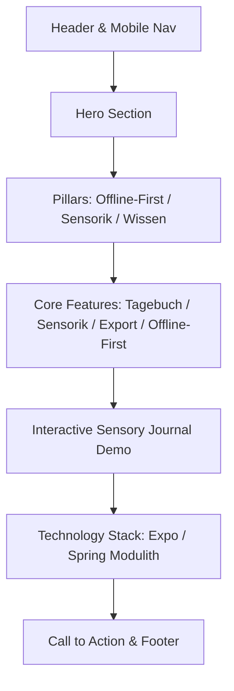

# Requirements

### Overview & Goals
The goal of this change is to update the Tasteney marketing website (`website/index.html`, `website/styles.css`, and related assets) by:
1. Removing the drink archetypes showcase section and archetype-specific navigation/links.
2. Updating the messaging around offline functionality so that it accurately reflects an **offline-first** philosophy — drinks can always be logged offline without an internet connection, while clarifying that the app is not strictly isolated/offline-only because backup and sync features will be added later.

### Scope
- **In Scope:**
  - Remove `<section class="categories-section" id="kategorien">` and all 8 archetype cards (Wein, Kaffee, Bier, Spirituosen, Tee, Cocktails, Soda & Tonics, Sonstiges) from `website/index.html`.
  - Update site navigation (header, mobile drawer, footer) to remove `#kategorien`.
  - Update hero CTAs and bottom CTA banners that link to `#kategorien`.
  - Replace the "8 Getränke-Archetypen" counter stat in the hero section.
  - Revise all occurrences of "100% Offline" / "ausschließlich offline" across meta tags, hero copy, pillars, feature cards, and footer to clarify offline-first logging with upcoming backup capabilities.
  - Clean up obsolete category section styles in `website/styles.css`.
- **Out of Scope:**
  - Changes to the Expo/React Native mobile app (`tasteney/`) or Spring Boot backend (`tasteney-be/`).
  - Implementing actual backup backend endpoints or frontend backup logic (planned for future tasks).

### User Stories
- As a prospective user visiting the website, I want to understand Tasteney's core tasting and sensory journaling capabilities without being constrained by fixed archetype groupings.
- As a user, I want clear and accurate messaging that I can log my drinks completely offline (e.g., in wine cellars, planes, or remote locations), while knowing that backup features will safeguard my data.

### Functional Requirements
- **Navigation & Links:** All navigation menus (`#header`, `#mobileDrawer`, footer) must have valid anchor targets (`#ueberblick`, `#funktionen`, `#sensorik`, `#technologie`). No broken links to `#kategorien`.
- **Hero & CTA Buttons:** Primary CTA buttons should direct users to `#funktionen` or `#sensorik`.
- **Offline & Backup Copy:**
  - Clear message: *"Immer & überall offline einsatzbereit – Getränke ohne Internet erfassen."*
  - Forward-looking: *"Lokale Datenspeicherung mit zukünftiger Cloud-Backup-Unterstützung."*

# Technical Design

### Current Implementation
- `website/index.html` includes:
  - Header & mobile nav links pointing to `#kategorien`.
  - Hero stats block displaying `8 Getränke-Archetypen`.
  - Dedicated `<section class="categories-section" id="kategorien">` spanning lines 272–434 with 8 drink category cards.
  - Texts claiming "100% Offline & Privat", "100% lokaler Speicher", with no mention of future backup/sync capabilities.
- `website/styles.css` defines `.categories-section`, `.categories-grid`, `.category-card`, and responsive breakpoint overrides.
- `website/script.js` powers the interactive sensory journal demo (`#sensorik`), which can remain as an interactive demo for tasting notes.

### Key Decisions
- **Remove Dedicated Archetypes Section:** Eliminate `<section class="categories-section" id="kategorien">` entirely rather than trying to adapt it, simplifying the landing page flow directly from Core Features (`#funktionen`) to the Interactive Sensory Guide (`#sensorik`).
- **Terminology Shift from "100% Offline Only" to "Offline-First & Backup-Ready":** Rephrase hard assertions like *"100% Offline"* and *"verbleiben ausschließlich lokal"* to *"Offline-First: Immer einsatzbereit auch ohne Internet"* and *"Sichere Speicherung mit zukünftiger Backup-Möglichkeit"*.

### Proposed Changes

#### 1. `website/index.html`
- **Header Navigation:**
  - Remove `<li><a href="#kategorien" class="nav-link">Kategorien</a></li>` from desktop and mobile nav.
  - Update CTA in header from `href="#kategorien"` to `href="#sensorik"` ("Sensorik entdecken" or "Ausprobieren").
- **Hero Section:**
  - Update hero description: clarify offline-first logging with future backup capabilities.
  - Update hero primary CTA: link to `#sensorik` ("Sensorik entdecken") or `#funktionen`.
  - Update hero stats: change `8 Getränke-Archetypen` to e.g. `Offline-First` or `1–10 Skala`.
- **Pillars & Features:**
  - Update Pillar 1 title and description: change from "100% Offline & Privat" to "Offline-First & Datensicherheit" (logging without internet, ready for future backups).
  - Update Pillar 3 and Feature 3: generalize tasting encyclopedia copy to focus on sensory flavor exploration and tasting notes without mentioning "8 Getränkegruppen / Archetypen".
  - Update Feature 4: change title to "Offline-First & Lokale Speicherung" with copy stating that drinks can be logged offline anywhere, with backup features coming soon.
- **Categories Showcase Section:**
  - Remove the entire `<section class="categories-section" id="kategorien">` block.
- **CTA Banner & Footer:**
  - Update CTA banner buttons to link to `#funktionen` and `#sensorik`.
  - Remove the category links column from footer and update privacy note to reflect offline-first with backup readiness.

#### 2. `website/styles.css`
- Remove obsolete `.categories-section`, `.categories-grid`, `.category-card`, `.category-image-wrap`, `.category-body`, `.category-desc` rules.
- Retain `.archetype-pill` / `.sub-pill` or general chip styles if still utilized in the hero sample card and interactive demo card.

### File Structure
- `website/index.html` (modified)
- `website/styles.css` (modified)
- `website/script.js` (verified/retained)

### Architecture Diagram

# Testing

### Validation Approach
- Inspect `website/index.html` to confirm all references to `#kategorien` and archetype showcase grids are eliminated.
- Verify that all internal anchor links (`#ueberblick`, `#funktionen`, `#sensorik`, `#technologie`) in header, mobile drawer, hero CTAs, and footer route to existing sections.
- Verify that all offline-related copy accurately communicates offline-first reliability (no internet required for drink logging) alongside future backup capabilities.
- Inspect responsive CSS layout to ensure smooth vertical flow between Features and Interactive Sensory Demo without visual breakage.

### Key Scenarios
- **Navigation Flow:** Clicking navigation links on desktop and mobile smoothly navigates to the respective section.
- **Content Accuracy:** Landing page messaging presents Tasteney as an offline-first sensory journal without referencing fixed 8 drink archetypes.
- **Offline Messaging Check:** Verify no contradictory claims like "purely offline without any cloud connectivity ever" remain.

# Delivery Steps

### ✓ Step 1: Update navigation and CTA references
The `index.html` navigation menus, hero section, CTA buttons, and footer links are updated to remove archetype dependencies.

- Update desktop header navigation (`.desktop-nav`) and mobile drawer (`#mobileDrawer`) to remove the `#kategorien` link.
- Update hero action button and CTA banner buttons from "Kategorien erkunden" to point to features or the interactive sensory guide (`#funktionen` / `#sensorik`).
- Replace the "8 Getränke-Archetypen" hero stat counter with an offline-first / sensory journaling metric.
- Update footer navigation columns to remove the archetype/categories links.

### ✓ Step 2: Remove beverage archetypes showcase section
The dedicated 8-card beverage archetypes showcase section is removed and accompanying feature/pillar texts are generalized.

- Remove the entire `<section class="categories-section" id="kategorien">` containing the 8 archetype cards from `index.html`.
- Update the "Enzyklopädie & Wissen" pillar and feature descriptions to focus on beverage journaling, sensory flavor matrices, and tasting notes rather than fixed 8 archetypes.
- Clean up or prune obsolete archetype showcase CSS classes in `styles.css` while preserving reusable utility badges.

### ✓ Step 3: Update offline-first and backup messaging across website copy
All website copy accurately conveys that Tasteney is offline-first (logging works without internet) while accommodating upcoming backup functionality.

- Update `<meta name="description">` and OpenGraph meta descriptions to reflect offline-first capability and cloud backup readiness.
- Update Hero description and hero preview status labels to emphasize reliable offline logging.
- Update Pillar 1 ("Offline & Datensicherheit") to highlight offline logging anywhere with upcoming backup options.
- Update Feature 4 ("Lokale Speicherung & Offline-Fähigkeit") bullets and description to state that drinks can always be logged offline without network access, with backup features coming in the future.
- Update footer tagline and privacy note to align with offline-first and backup-ready data storage.