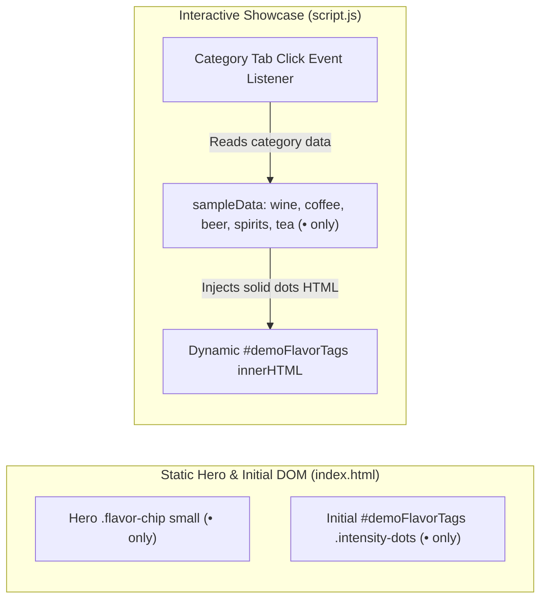

# Requirements

### Overview & Goals
Enhance the visual clarity of aroma descriptor intensity scales on the Tasteney marketing website by removing all empty circle glyphs (`◦`). Each aroma descriptor intensity (scale 1–5) will be represented solely by solid dots (`•`) matching the rating (e.g., 3/5 intensity is represented as `•••` instead of `•••◦◦`).

### Scope
#### In Scope
- Static HTML elements in `website/index.html` displaying flavor tags in the Hero preview card (`.flavor-chip small`) and the Interactive Showcase initial card (`.intensity-dots`).
- Dynamic interactive preview dataset in `website/script.js` (`sampleData`) for all beverage categories (`wine`, `coffee`, `beer`, `spirits`, `tea`).
- Style verification in `website/styles.css` for `.intensity-dots` and `.flavor-chip small` to ensure optimal visual spacing.

#### Out of Scope
- Mobile application (`tasteney/`) and backend (`tasteney-be/`) source code.
- Changes to descriptor names, rating algorithms, or category definitions.

### User Stories
- As a website visitor, I want aroma intensity ratings to display only solid dots representing their score so that I can quickly assess the aroma profile at a glance without visual clutter from empty circles.

### Functional Requirements
- **Scale Mapping**:
  - Intensity 1: `•` (1 solid dot)
  - Intensity 2: `••` (2 solid dots)
  - Intensity 3: `•••` (3 solid dots)
  - Intensity 4: `••••` (4 solid dots)
  - Intensity 5: `•••••` (5 solid dots)
- **Zero Empty Circles**: No empty circle characters (`◦` / `U+25E6`) shall appear anywhere in descriptor pills, chips, or tag elements on the website.
- **Dynamic Category Switching**: When the user switches between category tabs (Wein, Kaffee, Bier, Spirituosen, Tee), the rendered flavor tags in `#demoFlavorTags` must display only solid dots for each descriptor.

# Technical Design

### Current Implementation
- `website/index.html`:
  - Hero preview card (lines 142–145) hardcodes `.flavor-chip` elements with trailing empty circles (e.g. `Leder & Tabak <small>••••◦</small>`, `Veilchen <small>•••◦◦</small>`).
  - Interactive showcase (lines 312–315) hardcodes initial `.flavor-tag` elements inside `#demoFlavorTags` with trailing empty circles (e.g. `Zeder & Tabak ••••◦`, `Graphit •••◦◦`).
- `website/script.js`:
  - Contains `sampleData` with flavor descriptors for `wine`, `coffee`, `beer`, `spirits`, and `tea`. Each descriptor defines a `dots` string containing a 5-character string mixing `•` and `◦`.
  - On category tab click, `script.js` injects HTML into `#demoFlavorTags` using `f.dots`.
- `website/styles.css`:
  - Styles `.flavor-chip small` and `.intensity-dots` with `color: var(--gold-dark)` and `letter-spacing: -1px`.

### Proposed Changes
1. **`website/index.html`**:
   - Update `.flavor-pills-row` in Hero card:
     - `Reife Kirsche <small>•••••</small>` -> unchanged (5 dots)
     - `Leder & Tabak <small>••••◦</small>` -> `Leder & Tabak <small>••••</small>` (4 dots)
     - `Veilchen <small>•••◦◦</small>` -> `Veilchen <small>•••</small>` (3 dots)
     - `Trüffel <small>••••◦</small>` -> `Trüffel <small>••••</small>` (4 dots)
   - Update `#demoFlavorTags` initial HTML:
     - `Schwarze Johannisbeere •••••` -> unchanged (5 dots)
     - `Zeder & Tabak ••••◦` -> `Zeder & Tabak ••••` (4 dots)
     - `Graphit •••◦◦` -> `Graphit •••` (3 dots)
     - `Dunkle Schokolade ••••◦` -> `Dunkle Schokolade ••••` (4 dots)

2. **`website/script.js`**:
   - Update `sampleData` definitions:
     - `wine`: Zeder & Tabak (`••••`), Graphit (`•••`), Dunkle Schokolade (`••••`), Schwarze Johannisbeere (`•••••`)
     - `coffee`: Bergamotte (`•••••`), Jasminblüte (`••••`), Pfirsich (`•••••`), Zitrusnote (`•••`)
     - `beer`: Maracuja (`•••••`), Mango & Ananas (`••••`), Harzig (`••`), Hafercreme (`••••`)
     - `spirits`: Torfrauch (`•••••`), Jod & Meersalz (`•••••`), Vanille (`•••`), Eichenholz (`••••`)
     - `tea`: Umami (`•••••`), Frisches Seegras (`••••`), Süße Erbse (`•••`), Vegetabil (`••••`)

3. **`website/styles.css`**:
   - Verify `.intensity-dots` and `.flavor-chip small` spacing and alignment for variable-length dot strings (1–5 dots) to maintain visual hierarchy.

### Data Models / Contracts

| Category | Descriptor | Old Representation | New Representation | Intensity |
| :--- | :--- | :--- | :--- | :--- |
| **Hero Card** | Reife Kirsche | `•••••` | `•••••` | 5/5 |
| **Hero Card** | Leder & Tabak | `••••◦` | `••••` | 4/5 |
| **Hero Card** | Veilchen | `•••◦◦` | `•••` | 3/5 |
| **Hero Card** | Trüffel | `••••◦` | `••••` | 4/5 |
| **Wine** | Schwarze Johannisbeere | `•••••` | `•••••` | 5/5 |
| **Wine** | Zeder & Tabak | `••••◦` | `••••` | 4/5 |
| **Wine** | Graphit | `•••◦◦` | `•••` | 3/5 |
| **Wine** | Dunkle Schokolade | `••••◦` | `••••` | 4/5 |
| **Coffee** | Bergamotte | `•••••` | `•••••` | 5/5 |
| **Coffee** | Jasminblüte | `••••◦` | `••••` | 4/5 |
| **Coffee** | Pfirsich | `•••••` | `•••••` | 5/5 |
| **Coffee** | Zitrusnote | `•••◦◦` | `•••` | 3/5 |
| **Beer** | Maracuja | `•••••` | `•••••` | 5/5 |
| **Beer** | Mango & Ananas | `••••◦` | `••••` | 4/5 |
| **Beer** | Harzig | `••◦◦◦` | `••` | 2/5 |
| **Beer** | Hafercreme | `••••◦` | `••••` | 4/5 |
| **Spirits** | Torfrauch | `•••••` | `•••••` | 5/5 |
| **Spirits** | Jod & Meersalz | `•••••` | `•••••` | 5/5 |
| **Spirits** | Vanille | `•••◦◦` | `•••` | 3/5 |
| **Spirits** | Eichenholz | `••••◦` | `••••` | 4/5 |
| **Tea** | Umami | `•••••` | `•••••` | 5/5 |
| **Tea** | Frisches Seegras | `••••◦` | `••••` | 4/5 |
| **Tea** | Süße Erbse | `•••◦◦` | `•••` | 3/5 |
| **Tea** | Vegetabil | `••••◦` | `••••` | 4/5 |

### Architecture Diagram

# Testing

### Validation Approach
Verify that all aroma descriptor chips and tags across `website/index.html` and `website/script.js` render only solid dots (`•`) and contain zero occurrences of empty circles (`◦`).

### Key Scenarios
1. **Initial Page Load**:
   - Hero preview card renders:
     - Reife Kirsche with 5 solid dots (`•••••`)
     - Leder & Tabak with 4 solid dots (`••••`)
     - Veilchen with 3 solid dots (`•••`)
     - Trüffel with 4 solid dots (`••••`)
   - Interactive demo initial state (Wine) renders:
     - Schwarze Johannisbeere with 5 solid dots (`•••••`)
     - Zeder & Tabak with 4 solid dots (`••••`)
     - Graphit with 3 solid dots (`•••`)
     - Dunkle Schokolade with 4 solid dots (`••••`)

2. **Category Tab Switching**:
   - Click "Kaffee": verifies Bergamotte (`•••••`), Jasminblüte (`••••`), Pfirsich (`•••••`), Zitrusnote (`•••`).
   - Click "Bier": verifies Maracuja (`•••••`), Mango & Ananas (`••••`), Harzig (`••`), Hafercreme (`••••`).
   - Click "Spirituosen": verifies Torfrauch (`•••••`), Jod & Meersalz (`•••••`), Vanille (`•••`), Eichenholz (`••••`).
   - Click "Tee": verifies Umami (`•••••`), Frisches Seegras (`••••`), Süße Erbse (`•••`), Vegetabil (`••••`).

3. **Global Codebase Search**:
   - Run text search across `website/` to ensure no remaining `◦` (U+25E6) characters exist in any HTML, JS, or CSS file.

# Delivery Steps

### ✓ Step 1: Update static HTML aroma intensity indicators in index.html
The static hero preview card and initial interactive demo section in `website/index.html` display only solid dots without empty circles.

- Update `.flavor-pills-row` in the hero preview card of `website/index.html` to replace `••••◦` with `••••`, `•••◦◦` with `•••`, and retain `•••••`.
- Update `#demoFlavorTags` in the initial interactive demo section of `website/index.html` to eliminate all trailing `◦` characters from `.intensity-dots` spans.
- Ensure all static HTML flavor chips and tags reflect the exact intensity level (e.g. 3/5 rendered as `•••`).

### ✓ Step 2: Update dynamic showcase data in script.js and verify CSS styling
All beverage categories in the interactive showcase dynamically render solid dots only, with consistent styling across viewports.

- Update the `sampleData` dictionary in `website/script.js` across all 5 drink categories (`wine`, `coffee`, `beer`, `spirits`, `tea`) so that descriptor `dots` values contain only solid dot characters (`•`) matching their respective ratings (1 to 5 dots).
- Verify `.intensity-dots` and `.flavor-chip small` styles in `website/styles.css` to ensure dot spacing, alignment, and letter spacing remain visually balanced without empty circle placeholders.
- Perform end-to-end verification across all category preview tabs to confirm no `◦` characters remain on the website.